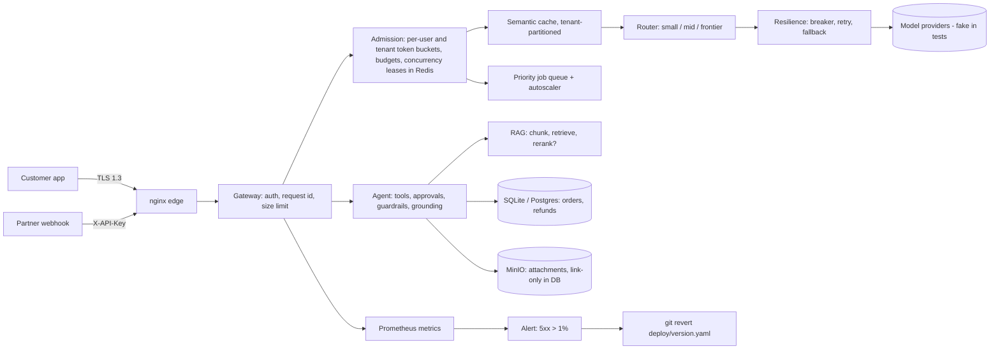

# AI System Design at Scale — Quillmoor Market

**Recruiter summary.** A runnable reference for taking an AI support agent from a demo to an at-scale platform for a fictional online store, **Quillmoor Market**. It covers the gateway, admission control, a semantic cache, a model router, resilience, queues, RAG, evals, auth, networking, the backend and DevOps. Every number below comes from a script in this repo. Load numbers are **simulated**: they run in-process against fake model providers, so they show which way a pattern moves a metric, not real capacity. The Kubernetes rollout numbers come from a real **kind** cluster in GitHub Actions.

<!-- run: python scripts/count_tests.py -->
```text
87 tests collected
```
<!-- /run -->

## Who it is for
- **Engineers** who want working code for each pattern, plus a test that proves it.
- **Interviewers and recruiters**, who can start at [docs/INTERVIEW_WALKTHROUGH.md](docs/INTERVIEW_WALKTHROUGH.md).
- **Adopters**, who can follow [docs/implementation-guide.md](docs/implementation-guide.md).

## Constraints envelope
Free tier only. No paid cloud resources, and nothing is ever applied. `terraform/` and `infra/` describe an Azure layout, and CI only validates them. **Applying them costs money and needs Jagadish's explicit yes.** All companies and people are fictional.

## Architecture


## How it works, step by step
1. **Edge.** nginx terminates TLS 1.3, limits body size and hides admin routes. The gateway then checks the bearer JWT (customers), the session (internal tools) or the API key (partners). It adds a request id and rejects bodies over 16 KB with a 413.
2. **Admission.** Each request passes Redis Lua token buckets for the user, then the tenant, then daily and monthly token budgets, then a concurrency lease. Each failed check returns a 429 that names its reason.
3. **Cache, router, resilience.** A tenant-partitioned semantic cache answers repeat questions. The router sends easy turns to a small model. A circuit breaker with fallback stops a provider outage from becoming user-facing errors.
4. **Agent.** The agent only calls tools that are on its allow-list. A refund needs owner confirmation and a digest-bound approval. Output guards, grounding and citation checks block invented numbers.
5. **Evals and release.** A 15-scenario suite gates each change. A drift watcher flags metric shifts. An error rate above 1% triggers a `git revert` of the last desired-state commit.
6. **Deploy.** The image is tagged with the git SHA. Kubernetes runs a RollingUpdate with `maxUnavailable: 0` and readiness probes, so a broken release never receives traffic.

## Measured results (real runs, this repo)
| What | Before | After | Source |
|---|---|---|---|
| Semantic cache, 80 FAQ requests (simulated) | 80 model calls, $0.002124 | 32 calls, $0.000819 (hit rate 0.75) | `results/loadtest_ci.json` |
| Router, 80 mixed requests (simulated) | $0.022275 | $0.010125 | same |
| Provider outage, 80 requests (simulated) | error rate 0.3375 | 0.0 (fallbacks used) | same |
| Queue drain, 150 jobs (simulated) | 1.679 s, 1 worker | 0.253 s, 8 workers | same |
| Noisy neighbour, normal-user p95 (simulated, ci scale) | 89.78 ms | 65.19 ms; abuser gets 429 at a rate of 0.875 | same |
| DB index, 200k rows (real sqlite) | SCAN, 6.83 ms per lookup | SEARCH USING INDEX, 0.0052 ms | `results/benchmarks.json` |
| Sticky routing, cache hit rate | round-robin 0.388 | CHWBL 0.80 (max load 58 vs avg 50) | same |
| Context funnel | 13,055 tokens | 25 tokens | same |
| Eval suite (15 self-written scenarios: a regression check, not a quality claim) | — | success 1.0; a known-bad candidate is blocked | `python -m sysdesign.evals` |
| k8s v1→v2 rollout under load (real kind) | — | see `results/k8s_rollout.json` | CI artifact |

<!-- run: python -m sysdesign.evals -->
```text
{"task_success_rate": 1.0, "scenarios": 15, "bad_candidate_deploy": false}
```
<!-- /run -->

**Known failure kept visible.** At full simulated scale (40 users, a tenant concurrency cap of 16), admission sheds 68.5% of *normal* users' requests with a `concurrency` 429, while the abuser is rejected at a rate of 0.978. The tenant-wide cap is not fair across users. See [docs/PITFALLS.md](docs/PITFALLS.md).

## How to run
```bash
python -m venv .venv && . .venv/bin/activate && pip install -r requirements-dev.txt
python -m pytest -q                       # offline, uses fakeredis
python -m loadtest.harness --scale ci     # simulated load, writes results/
python -m loadtest.benchmarks             # batching, index, reranker, chunk size
python -m scripts.estimate --scale 10     # capacity and cost at 10x
docker compose up -d                      # optional local stack (written, not run in CI)
bash scripts/kind_rollout.sh              # needs docker + kind; CI runs it
```

## Built / Written-not-run / Planned
| Status | Items |
|---|---|
| **Built and tested** | Gateway auth (JWT, sessions, API keys, mock OIDC), admission, cache, router, resilience, queue and autoscaler, agent tools and approvals, guardrails, grounding, RAG, evals and the drift gate, alert → git revert, backend (transactions, index, object store), SSE order events, networking probes, a k8s rollout on kind (CI), terraform/bicep validate (CI), a Docker image tagged with the git SHA (CI) |
| **Written, not run** | `docker-compose.yml` (nginx, 3 API replicas, redis, postgres, minio, prometheus, grafana, otel), `scripts/segmentation_check.sh`, the Grafana dashboard |
| **Planned** | Argo CD sync (`deploy/argocd/application.yaml`), CDN in front of object storage, brotli, per-user concurrency fairness, GHCR push, tflint and checkov, any cloud apply (needs Jagadish's yes) |

## Docs
[Requirements](docs/requirements.md) · [Agent boundaries](docs/agent-boundaries.md) · [Design stack](docs/design-stack.md) · [Threat model](docs/threat-model.md) · [ADRs](docs/adr/) · [Interview walkthrough](docs/INTERVIEW_WALKTHROUGH.md) · [What is agentic](docs/WHAT_IS_AGENTIC.md) · [Networking](docs/NETWORKING_JOURNEY.md) · [Backend evolution](docs/BACKEND_EVOLUTION.md) · [DevOps journey](docs/DEVOPS_JOURNEY.md) · [Authentication](docs/AUTHENTICATION.md) · [Latency](docs/LATENCY.md) · [Capacity](docs/CAPACITY.md) · [RAG pipeline](docs/RAG_PIPELINE.md) · [Enterprise](docs/ENTERPRISE.md) · [Pitfalls](docs/PITFALLS.md) · [Defense Q&A](docs/DEFENSE_QA.md) · [Coverage map](docs/COVERAGE_MAP.md) · [Implementation guide](docs/implementation-guide.md) · [Interview points](docs/interview-points.md)

## Guardrails and security
Least-privilege tools, approval before refunds, injection and poisoned-document isolation, PII redaction in traces, cache and feedback, hashed API keys, refresh-token family revocation, CodeQL, gitleaks, a hashed brand blocklist, and Dependabot. See [SECURITY.md](SECURITY.md) and [docs/threat-model.md](docs/threat-model.md).

## Related repos
- [Jagadish-agent-auth-security](https://github.com/jagadishmazure-jpg/Jagadish-agent-auth-security) covers agent auth in depth. This repo keeps auth slim and links there.

## License
MIT
