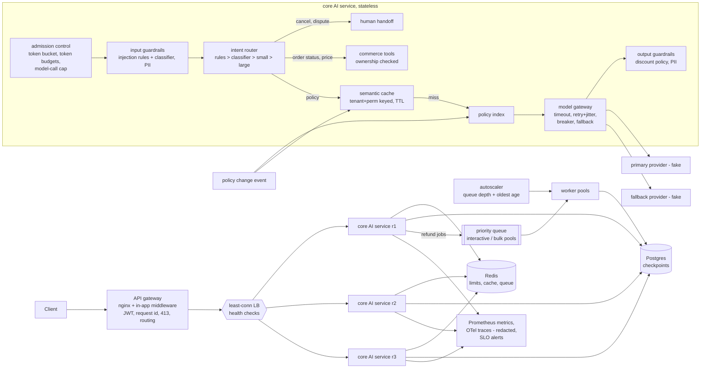

# AI System Design at Scale — the system around a working agent

> Fictional company, fake model providers, simulated scale. Independent project,
> not affiliated with any vendor or employer. **Kestrel Goods** is an invented
> online retailer; every order, user and policy here is made up.

**Recruiter summary.** A support agent that works for five users usually fails
for ten thousand, and the model is rarely the reason: the failures come from
how requests get in, wait, fail and scale. This repo wraps one FastAPI support
agent (policy RAG, order tracking, refunds, human escalation) in twelve
production patterns implemented as tested code, then replays the same seeded
traffic with each pattern off and on so the effect is a number, not a claim.
<!-- BEGIN SUMMARY -->
**396 tests.** In the load model (virtual time, fake providers): rate limiting kept normal users' p95 at 1.271s versus 9.988s and errors at 0.0% versus 79.4% while one user flooded; the intent ladder cut model spend 15.3x; breaker + fallback took outage-window errors from 100.0% to 0.0%; the semantic cache served 98.6% of policy questions with 0 wrong-source hits.
<!-- END SUMMARY -->

## Who it is for

- **Interviewers and reviewers:** a system-design answer you can run, with
  before/after numbers for each pattern.
- **Engineers adopting the patterns:** small, readable modules with the edge
  cases tested (see `docs/implementation-guide.md`).
- **The owner:** interview preparation (`docs/interview-points.md`, and the
  [interview playbook](docs/interview-playbook.md)).

## Architecture



## How one request flows

1. **Gateway** (`deploy/nginx.conf`, `sysdesign/app.py`): one entrance. nginx
   caps bodies at 16 KB, applies a coarse per-IP limit and balances across three
   replicas, retrying a dead one. In the app, middleware assigns or validates a
   request id, rejects oversized bodies with 413 before any auth work, verifies
   an RS256 JWT (issuer, audience, expiry, tenant; `alg` pinned) and routes only
   known paths. See `docs/api-gateway-vs-model-gateway.md`.
2. **Admission control** (`sysdesign/admission.py`): a Redis Lua token bucket
   per tenant+user, then daily and monthly LLM-token budgets (reserve an
   estimate, settle actual usage), then a cluster-wide cap on concurrent model
   calls held as expiring leases. Rejections return 429 with `Retry-After`.
   Every replica shares the same Redis, so three replicas don't triple anyone's limit.
3. **Input guardrails** (`sysdesign/guardrails.py`): injection rules on
   normalised text (NFKC, zero-width characters stripped) plus a weighted
   feature classifier for paraphrases; PII redaction for cards (Luhn-checked),
   emails, phones and SSNs.
4. **Intent router** (`sysdesign/router.py`): the cheapest rung that is good
   enough. Rules answer greetings and order status; a small classifier handles
   refund and price requests; a small model answers policy questions with
   retrieval; the large model is reserved for requests flagged complex.
   Cancellations, billing disputes, chargebacks and legal threats go straight to a
   human, before any other rule runs.
5. **Semantic cache** (`sysdesign/cache.py`): only knowledge (policy)
   answers, never prices, order data, tool actions or questions containing
   PII. Keyed by tenant and permission set, with a similarity threshold and a TTL.
   Each entry records the chunks it was built from.
6. **Change data capture** (`sysdesign/knowledge.py`,
   `SupportAgent.on_policy_change`): when a policy document changes, only
   chunks whose content hash changed are re-embedded, and only cache entries
   built on those chunks are dropped.
7. **Model gateway** (`sysdesign/resilience.py`): per-attempt timeout, at most
   two retries with full-jitter exponential backoff, a closed/open/half-open
   breaker per provider, then failover to the fallback provider. If both are
   down, the user gets an explicit "can't answer right now" and the reserved
   tokens are refunded. The agent never guesses.
8. **Output guardrails**: no credit above the 10% policy, no binding promises, no
   prices from model text (prices only come from the pricing tool), PII redacted.
9. **Refunds are jobs** (`sysdesign/jobqueue.py`, `sysdesign/workflow.py`):
   `POST /v1/refunds` needs an `Idempotency-Key`, scoped per user. The job goes to
   a Redis queue with priorities, a bounded backlog, a maximum wait, leases, a
   DLQ and separate pools. The workflow checkpoints each step to Postgres
   (SQLite in tests), so a replica killed mid-way is resumed elsewhere and the
   refund is issued exactly once.
10. **Autoscaler** (`sysdesign/autoscaler.py`, `sysdesign/worker.py`): scales
    worker pools on queue depth and oldest-task age, keeps a warm minimum,
    models start-up delay and waits out a cooldown before scaling down. CPU is
    deliberately not an input.
11. **Streaming** (`POST /v1/chat/stream`): Server-Sent Events, with time to
    first event recorded in `sd_time_to_first_token_seconds`.
12. **Observability** (`sysdesign/observability.py`, `deploy/alerts.yml`):
    Prometheus counters and histograms, OpenTelemetry spans redacted at export,
    SLO alerts for p95 latency, spend and token burn (they refuse to pass on too
    few samples), and online functional evals that check the right tools ran for
    each intent.

## Measured results (load model, off vs on)

`python -m loadtest.harness` replays identical seeded traffic through the real
components with each pattern switched off and then on. It runs in virtual time with
fake providers: these are **model results at small simulated scale (about
1,000 to 4,000 requests per scenario), not a hardware benchmark**. Latency
percentiles cover successful responses; error and 429 rates are reported
separately so failures cannot flatter latency. CI regenerates the JSON and
fails if `loadtest/results/results.json` or the tables below drift.

<!-- BEGIN RESULTS -->
| Pattern | Metric | Off | On |
| --- | --- | ---: | ---: |
| Rate limiting (normal users while one user floods) | p95 / error rate | 9.988s / 79.4% | 1.271s / 0.0% |
| Rate limiting (the flooding user) | 429 rate | 0.0% | 92.9% |
| Semantic cache (policy questions) | hit rate / cost per 1k / p50 | 0.0% / $0.0131 / 0.265s | 98.6% / $0.0027 / 0.012s |
| Semantic cache correctness | hits citing different sources than fresh retrieval | n/a | 0 of 774 |
| Intent router ladder (mixed traffic) | cost per 1k / p95 | $0.3137 / 1.669s | $0.0204 / 0.940s |
| Breaker + fallback (primary down 60s of 180s) | error rate during outage / disrupted seconds | 100.0% / 60 | 0.0% / 0 |
| Breaker + fallback | calls sent to the failing primary | 1780 | 714 |
| Health-checked load balancer (1 of 3 replicas dies at 30s) | error rate | 21.4% | 0.5% |
| Bulkheads + autoscaler (bulk burst + interactive jobs) | interactive wait p95 | 585.400s | 1.900s |
| Bulkheads + autoscaler | bulk backlog drain time | 621.600s | 118.000s |
<!-- END RESULTS -->

Cost per ladder rung (mixed traffic, ladder on):

<!-- BEGIN PATHS -->
| Ladder rung | Requests | Cost per 1k requests |
| --- | ---: | ---: |
| classifier | 246 | $0.0111 |
| large_model | 53 | $0.2250 |
| rules | 229 | $0.0000 |
| small_model | 488 | $0.0125 |
<!-- END PATHS -->

Things the numbers do not show: the cache scenario draws from 18 phrasings of
6 questions, so its hit rate is far higher than real traffic would give. The
"off" outage mode recovers instantly when the provider returns because it has
no breaker to wait out. That is the honest trade: the breaker costs a few
probe intervals of recovery, and in return it cuts calls to a failing provider.

## Capacity (back of the envelope, computed)

`python scripts/capacity.py` (override any input, e.g. `users=50000 peak_multiplier=20`).
Defaults: 10,000 users, 5 requests each per day, 10x peak. Full reasoning in
[`docs/capacity.md`](docs/capacity.md).

## Code excerpt and its real output

```python
from sysdesign.router import route
for q in ["hi", "where is my order KG-100001", "what is the return window for electronics",
          "my split shipment from two orders has a missing item", "I want to cancel my membership"]:
    r = route(q); print(r.intent, r.rung, r.model_tier)
```

```text
greeting rules None
order_status rules None
policy small_model small
complex large_model large
escalate human None
```

## How to run

Offline, no keys, no cloud:

```bash
python -m venv .venv && . .venv/bin/activate
pip install -r requirements-dev.txt
python -m pytest -q                 # in-process: fakeredis + SQLite
python -m loadtest.harness          # regenerate results.json
python scripts/render_docs.py       # regenerate README numbers
python scripts/capacity.py
python -m loadtest.talks_benchmarks # batching, sticky routing, RAG, index proof -> talks_benchmarks.json
python -m scripts.estimate_10m --scale 10   # 10M-user cost model at 10x
```

Kubernetes (free, local): with Docker and kind installed, `kind create cluster`
then `bash scripts/kind_rollout.sh`. It builds the image tagged with the git SHA,
rolls v1 to v2 under in-cluster load, then rolls a broken v3 that must halt.
CI runs the same script in the `image-and-kind-rollout` job.

Local cluster (Docker, free): `python scripts/dev_token.py` creates a dev
signing key and prints a token, then run `docker compose up --build`. That starts
nginx, 3 API replicas, Redis, Postgres, an autoscaler, two worker pools and
Prometheus. Send requests to `http://localhost:8080/v1/chat` with
`Authorization: Bearer <token>`. CI runs `scripts/compose_smoke.sh` against
the same compose file. There is no cloud deployment and none is planned
without a cost estimate first.

## Guardrails and security controls

- RS256 JWT with pinned algorithm, issuer, audience, expiry and tenant
  checks. Unknown `kid`, `alg=none` and foreign keys are all rejected (tests).
- Admin policy updates require the `policy:write` scope.
- Tools check order ownership and return the same "not found" for missing and
  other people's orders. Job status is owner-scoped, and idempotency keys are
  scoped per tenant and user.
- Refund and credit policy is enforced in code: positive and finite amounts, no
  more than the order total across refunds, credit capped at 10% and once per order.
- Rate tokens are charged before guardrails, so blocked injection attempts
  aren't free to spam.
- PII is redacted on input, output, human handoff notes, cache entries and
  trace export. Questions containing PII are never cached.
- Negative token estimates and token counts are rejected, so they can't refill
  a budget. NaN and inf refund amounts get a 422.
- Threat model: [`docs/threat-model.md`](docs/threat-model.md). ADRs: [`docs/adr/`](docs/adr).

## Limitations and known failures

- Providers are fakes. Latency, failures and token counts are simulated, and
  prices are illustrative tier prices with an as-of date, not vendor quotes.
- The embedding is a hashed bag of words. Paraphrases with no shared words
  miss the cache, which is safer than wrong hits but lowers the hit rate.
- The semantic cache scans a namespace linearly. That's fine for hundreds of
  entries, but a vector index is needed beyond that.
- The injection classifier is a keyword-weight stand-in, not a trained model.
  Novel phrasings can get through, and the rule list needs owners.
- `/v1/chat/stream` generates the full reply, then streams it. TTFT here
  measures time to the first SSE event, not true provider token streaming.
- Commerce data is in-memory per process. In compose, the API and the workers
  each hold their own copy of the fictional orders.
- The in-app 413 check buffers bodies sent without a length header. nginx's
  `client_max_body_size` is the real cap in front.
- The load model schedules replica slots in arrival order, an approximation
  of real concurrency. Breaker timing within overlapping requests is approximate.

## Built vs planned

| Item | Status |
| --- | --- |
| Gateway middleware, JWT, 413, request ids, routing | Built, tested |
| Redis token bucket, token budgets, model-call cap, 429 + Retry-After | Built, tested (fakeredis; real Redis in CI integration job) |
| Input/output guardrails, action policy, PII redaction | Built, tested |
| Intent router ladder + HITL + cost per path | Built, tested, measured |
| Semantic cache + CDC re-index/invalidation | Built, tested, measured |
| Queue: priority, bounded, max wait, DLQ, idempotency, bulkheads | Built, tested, measured |
| Timeouts, retries + jitter, breaker, fallback, graceful degradation | Built, tested, measured |
| Checkpointed workflow + kill-mid-workflow chaos test | Built, tested (SQLite; Postgres in CI integration job) |
| Queue-depth/age autoscaler | Built, tested, measured |
| SSE streaming + TTFT metric | Built, tested |
| Prometheus metrics, redacted OTel traces, SLO alerts, functional evals | Built, tested |
| Capacity calculator | Built, tested |
| Interview playbook: envelope calculator + CLI, 7 worked cases, 44-question bank, docs drift check | Built, tested (illustrative prices) |
| docker compose (nginx, 3 replicas, Redis, Postgres, workers, autoscaler, Prometheus) | Built; smoke-tested in CI only (not run on the author's machine) |
| Talks 3-14 additions in `sysdesign/ext/` (see [coverage map](docs/coverage-map.md)) | Built, tested |
| Talk 15: LLM caching (prompt order, prefix cache, response + embedding caches, evidence board) | Built, tested (simulated; [caching.md](docs/caching.md)) |
| Talk 16: tail latency (fan-out math, slow-call breaker, per-dependency bulkheads, hedging, fallback ladder, deadline budget, evidence board) | Built, tested (simulated; [tail-latency.md](docs/tail-latency.md)) |
| Partner webhook with hashed, scoped API keys; SSE order push; `/version`; per-route status counter | Built, tested |
| Per-user share inside the model-call cap | Built, tested ([pitfalls](docs/pitfalls.md)) |
| k8s manifests, zero-downtime rollout and broken-release halt on kind | Built; run for real in CI (`image-and-kind-rollout`) |
| Terraform (Azure) and Bicep | Validated in CI only (`fmt`, `validate`, `bicep build`). Never applied |
| GitOps desired state + alert-driven git revert | Built, tested (temp git repo). Argo CD Application written, not installed (Planned) |
| Grafana dashboard (compose profile `observability`) | Written, not run; metric names checked by a test |
| Compose network segmentation (edge / app / data) | Planned |
| OTLP export to a trace backend | Planned |
| Trained guard model, real embeddings, vector index for the cache | Planned |
| Real provider adapters (keys from a secret store) | Planned |
| Cloud deployment | Not planned without an approved cost estimate |

## Talks 3-14: what was added

Twelve more talks (latency, 10M-user cost, RAG choices, enterprise governance,
MLOps, multi-agent and MCP, distributed systems, networking, backend evolution,
DevOps and authentication) were turned into code on a separate branch and then
ported here. Wherever main already had the pattern, the port reuses main's
version instead of adding a second one. Per-talk status and proof:
[`docs/coverage-map.md`](docs/coverage-map.md). Two findings from that work,
one about a metric that counted canned answers as successes and one about a
model-call cap with no per-user share, are written up in
[`docs/pitfalls.md`](docs/pitfalls.md).

Real run on a kind cluster in GitHub Actions (`loadtest/results/k8s_rollout.json`,
image `3ad781097f0c`): the v1 to v2 rolling update took 7.7 s and served 2,023
requests from an in-cluster load loop with 0 failures (465 answered by v1, 1,558
by v2). A broken v3 whose readiness check fails was then rolled out. The rollout
halted with all 3 v2 pods still ready, and 1,801 requests were served, 0 failed,
0 by v3.

Measured on one machine (`loadtest/results/talks_benchmarks.json`, simulated
where a model is involved): batching 16 vs 1 raised throughput from 195 to 844
rps; load-aware sticky routing raised prefix-cache hit rate from 0.388 to 0.80;
a sqlite index turned a 200k-row scan into an index search (about 1,350x faster
per lookup); the reranker added about 4 ms and no hit@1 gain, so it is off.

## Interview playbook

How to answer an open-ended AI system design question, with the numbers computed by `sysdesign/ext/envelope.py` (illustrative prices) and checked in CI by `scripts/render_interview.py --check`.

| Doc | What it covers |
|---|---|
| [interview-playbook.md](docs/interview-playbook.md) | Scoring, 45-minute budget, five questions mapped to decisions, envelope math, the per-conversation budget mistake, defense Q&A |
| [interview-cases/](docs/interview-cases/README.md) | Seven worked fictional cases: bank, retail, insurance claims, healthcare intake, mortgage Q&A, enterprise search, low-latency checkout |
| [interview-question-bank.md](docs/interview-question-bank.md) | 44 questions, each linked to the file or test that proves the answer |

## Talk 15: caching for LLM apps

A simulated replay of a fictional support assistant whose bill grew 3.11x while traffic grew 1.3x: a timestamp at the start of the prompt meant the provider's prompt cache never matched. Moving the stable parts first cut input cost 58.2% and simulated median TTFT from 0.826s to 0.454s. Details, evidence board and limits: [`docs/caching.md`](docs/caching.md).

## Talk 16: tail latency and resilience

A simulated replay of a moderation service that turned slow on 1% of calls: turn p99 went from 4.7s to 10.2s with no deploy and no traffic change. Calls in parallel cut the median but left p99 at 9.8s; adding a replica only delayed worker saturation by about 15s in a brownout. Hedging reads at p95 (4.2% extra calls) plus deadline-budget timeouts brought p99 to 4.3s, and a slow-call breaker plus a 12-slot moderation bulkhead kept the brownout from filling the workers. Details, evidence board and limits: [`docs/tail-latency.md`](docs/tail-latency.md).

## Related repos

- [Jagadish-agent-reliability-lab](https://github.com/jagadishmazure-jpg/Jagadish-agent-reliability-lab): failure injection for agents. This repo covers the traffic side.
- [Jagadish-agent-trace-observability](https://github.com/jagadishmazure-jpg/Jagadish-agent-trace-observability): deeper tracing and cost attribution.
- [Jagadish-unified-retrieval-router](https://github.com/jagadishmazure-jpg/Jagadish-unified-retrieval-router): retrieval routing in depth.
- [Jagadish-llm-capacity-planning](https://github.com/jagadishmazure-jpg/Jagadish-llm-capacity-planning): token-based capacity planning (separate talk).
- [Jagadish-azure-finops](https://github.com/jagadishmazure-jpg/Jagadish-azure-finops): cached-rate prompt pricing in a FinOps context.
- [Jagadish-pii-guard](https://github.com/jagadishmazure-jpg/Jagadish-pii-guard): PII detection in depth.
- [Jagadish-agent-roi-framework](https://github.com/jagadishmazure-jpg/Jagadish-agent-roi-framework): what the cost numbers mean for value.
- [Jagadish-food-ingredients-agentic-ai](https://github.com/jagadishmazure-jpg/Jagadish-food-ingredients-agentic-ai): flagship agent with infra-as-code.

## Credits

Patterns were prompted by 16 public talks on AI system design that the
owner shared, which are credited here by topic only. All text and code are
original, and no talk content is quoted.

<!-- BEGIN TESTCOUNT -->
396 tests collected
<!-- END TESTCOUNT -->

MIT licensed. See [SECURITY.md](SECURITY.md).
