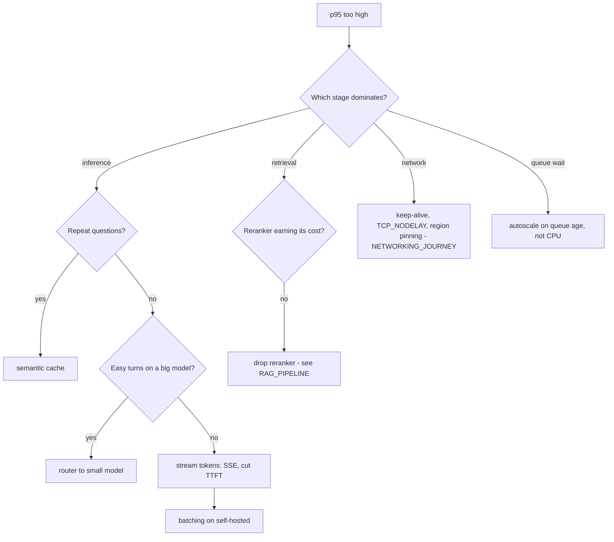

# Latency: where the time goes and what to do about it

Stage timings (simulated, `results/loadtest_ci.json`, p50): gateway + admission **0.77 ms**, retrieval **0.22 ms**, inference **18.0 ms**. Inference is about 95% of the total, so a faster model or fewer model calls beats tuning the gateway.

Doubling provider latency raised p95 from 84.7 to 166.07 ms (simulated, 40 requests). End-to-end tails follow the slowest dependency almost one-for-one.

Batching at a fixed offered load (simulated GPU model, `results/benchmarks.json`):
| Batch | p50 ms | p95 ms | Throughput rps |
|---|---|---|---|
| 1 | 512.4 | 977.48 | 195.2 |
| 4 | 64.68 | 124.81 | 619.5 |
| 16 | 19.15 | 27.04 | 846.8 |
At batch 1 the server cannot keep up, so the time is queueing, not compute. Batching raises throughput and that removes the queue.

## Decision tree

