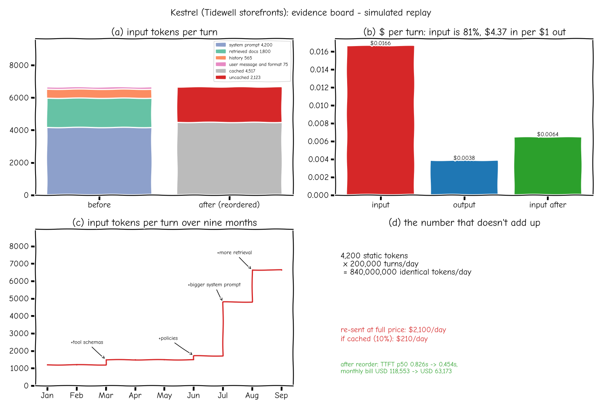
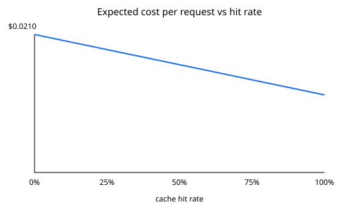
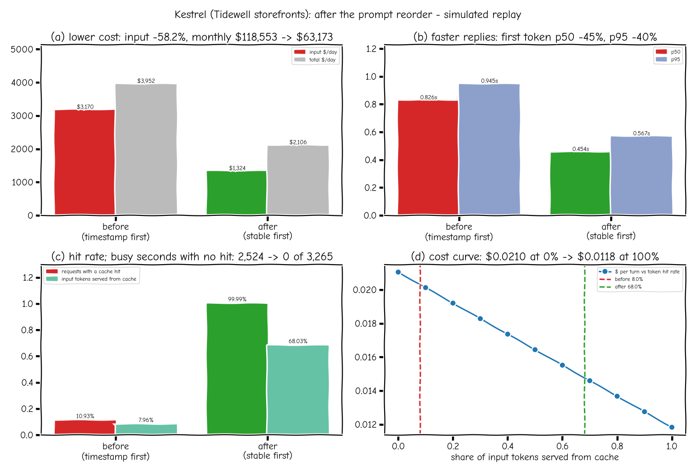

# Talk 15: caching for LLM apps (part 1)

Everything on this page is a **simulation** with illustrative prices (input $2.50, output $10.00 per 1M tokens, cached input at 10%, as of 2026-10) and a simulated prefill-time model. The numbers come from `python scripts/caching_bench.py` `python scripts/evidence_board.py` and `python scripts/caching_after_board.py`; CI fails if the committed results drift from a fresh run. Source: a public talk on AI system design, credited by topic only and paraphrased in my own words.

## The story (fictional)

Kestrel is a support assistant for shops on the made-up Tidewell storefront platform. Merchants ask it where an order is, what the refund rules say, or what is on a customer's account. Over two months its model bill grew far faster than its traffic. Two easy explanations came first: customers typing longer messages, or the provider charging more. Neither was true.

*Panel (c): only June and August are replayed; the other months are story points that show when tool schemas, policies, a larger system prompt and more retrieval were added.*

## Why a timestamp at the front breaks caching

A model reads a prompt left to right. The internal state it keeps for each token (the KV cache) is computed from that token **and every token before it**. So the provider can reuse stored work only for a prompt that begins with exactly the same tokens as an earlier one. Kestrel put the current time on line one. The time changes every second, so from the very first token every prompt was new, and the 4,200-token system prompt after it was paid for in full on every turn. The fix is to order the prompt from what never changes to what changes most: system prompt, merchant line, retrieved documents, history, the question, and the timestamp last.

The simulator (`sysdesign/ext/llm_cache.py`, `PrefixCacheSim`) follows provider rules: no caching under 1,024 matching tokens, matched length rounded down to 128-token blocks, a 5-minute lifetime that restarts on every hit, and cached tokens billed at 10%. Same approach as the cached-rate pricing in Jagadish-azure-finops.

## Results (one replayed hour at 200,000 turns a day, scaled to a day and a 30-day month)

| | June (timestamp first) | August (timestamp first) | August (reordered) |
|---|---|---|---|
| Turns per day | 153,846 | 200,000 | 200,000 |
| Average input tokens | 1,729.6 | 6,640.2 | 6,640.2 |
| Requests with any cached tokens | 3.1% | 10.9% | 100.0% |
| Share of input tokens cached | 2.9% | 8.0% | 68.0% |
| Input cost per day | $666.96 | $3,170.08 | $1,324.09 |
| Monthly bill | $38,072 | $118,553 | $63,173 |
| Simulated TTFT p50 / p95 | 0.4s / 0.432s | 0.826s / 0.945s | 0.454s / 0.567s |

- Bill grew **3.11x** while traffic grew **1.3x**; the prompt itself grew 3.84x.
- Wrong theories, ruled out with data: average user question stayed at 50 tokens in both months; the price table is identical in both.
- The confusing spikes: with the timestamp first, **all 937 cache hits** came from requests in the same second for the same merchant (including all 238 same-second retries), and 2,524 of 3,265 busy seconds had no hit at all. After reordering, no busy second was without hits.
- Reordering cut input cost by **58.2%**, the monthly bill from $118,553 to $63,173, and simulated median TTFT from 0.826s to 0.454s. These are my measured values; they are not tuned to match the talk.
- Input was 81.4% of each turn's cost ($4.37 of input per $1 of output). The static prompt alone is 840,000,000 identical tokens a day: $2,100.0/day at full price versus $210.0/day if cached.

Expected cost per request is `H x C_hit + (1 - H) x C_miss` (`expected_cost`, rejects negative costs and hit rates outside 0..1).

### Multi-turn conversations (12 turns, 30 s apart, 4,200-token system prompt)

| History handling | Share of input tokens cached |
|---|---|
| Append only | 88.0% |
| Rewritten every turn | 58.1% (only the system prompt is reused) |
| Summarised once at an 8,000-token limit, system prompt kept first | 86.3% (1 summary) |

### Response and embedding caches

- Exact-match `ResponseCache` (`sysdesign/cache.py`, cache-aside, 24 h TTL, key = tenant + hash of the normalized prompt) on 3,000 synthetic chat requests: 44.1% overall, 96.5% of policy questions. Order-status questions are never cached. Adding the existing `SemanticCache` behind it (threshold 0.85) found 0 extra hits on this set: its toy bag-of-words embedding does not match the reworded questions. Known gap, kept visible.
- Normalization folds case, extra spaces and edge punctuation, but a token with a digit keeps its case and inner marks, so `#A-1042` and `#A-1043` never share an answer (tested).
- Write-through `EmbeddingCache` keyed on a SHA-256 of model + text: re-indexing 1,000 chunks after 20 documents changed needed 40 embedding calls instead of 1,000 (96.0% hit rate).

### Cache-aside vs write-through

| | Cache-aside (response cache) | Write-through (embedding cache) |
|---|---|---|
| Who writes | The reader, after a miss | The writer (indexer), on every write |
| Staleness | Old answer can live until the TTL or a CDC invalidation | None: a changed text gets a new key |
| Cold start | First request for a key pays full cost | Already warm when the first query arrives |

## How the cache layers fit together

Browser cache (static assets) -> CDN (public pages) -> Redis (sessions, rate limits, the response and semantic caches) -> database buffer pool (hot rows and index pages). The LLM-specific layers sit beside them: the **response cache** skips the model entirely, the **embedding cache** skips re-embedding unchanged text, and the provider's **prompt cache** discounts a repeated prompt start. Each layer only helps if its key is stable.

## Guardrails

- Only policy-type intents are cached; questions with PII or order and account specifics are refused (tests).
- Tenant is part of every key; one merchant never reads another's answer.
- Answers are PII-redacted before storage.
- Input validation on all cost functions.

## Limitations

- Simulated provider and prefill model; real providers match per token block, not per prompt segment.
- One hour of uniform traffic scaled to a day; no daily peaks.
- Prices are illustrative.
- The semantic layer found no extra hits on reworded questions (toy embedding).

## After the fix: the second board

Same simulated August traffic, timestamp first vs stable content first. Values come straight from `docs/results/caching.json` (copied into `docs/results/caching_after_board.json`, drift-checked in CI):

- **Lower cost:** input $3,170 to $1,324 per day (-58.2%), total $3,952 to $2,106 per day, monthly bill $118,553 to $63,173.
- **Faster replies:** first-token p50 0.826s to 0.454s, p95 0.945s to 0.567s.
- **Hit rate:** requests with a hit 10.93% to 99.99%; input tokens served from cache 7.96% to 68.03%; busy seconds with no hit 2,524 to 0.

Panel-by-panel notes: [dashboards.md, section 1b](dashboards.md#1b-caching-after-board-talk-15).

## Built vs planned

| Item | Status |
|---|---|
| Cost formula, curve, prefix-cache simulator, prompt builder, incident replay | Built, tested (simulated) |
| Multi-turn append / rewrite / summarise | Built, tested (simulated) |
| Exact-match response cache, write-through embedding cache | Built, tested (fakeredis) |
| Evidence board figure, drift-checked in CI | Built |
| "After" evidence board (cost, first-token time, hit rate), drift-checked in CI | Built |
| Measuring a real provider's cached-token counts | Planned |
| Part 2 of the caching talk | Planned |
