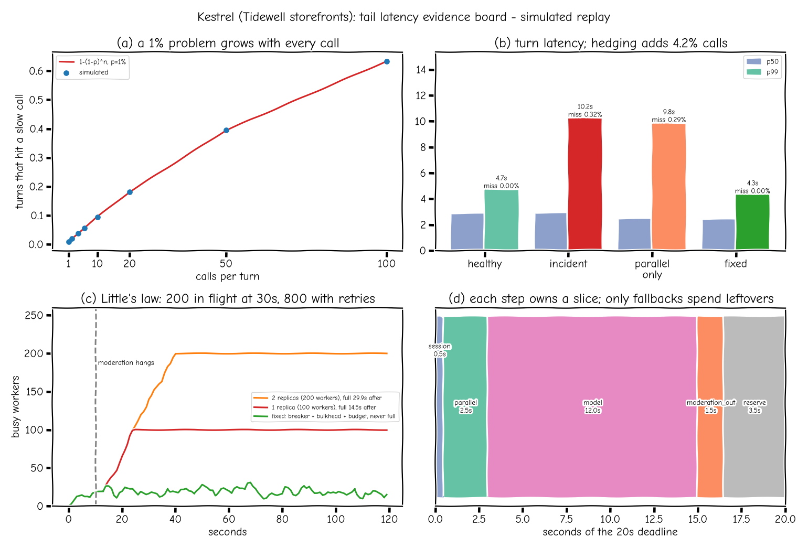
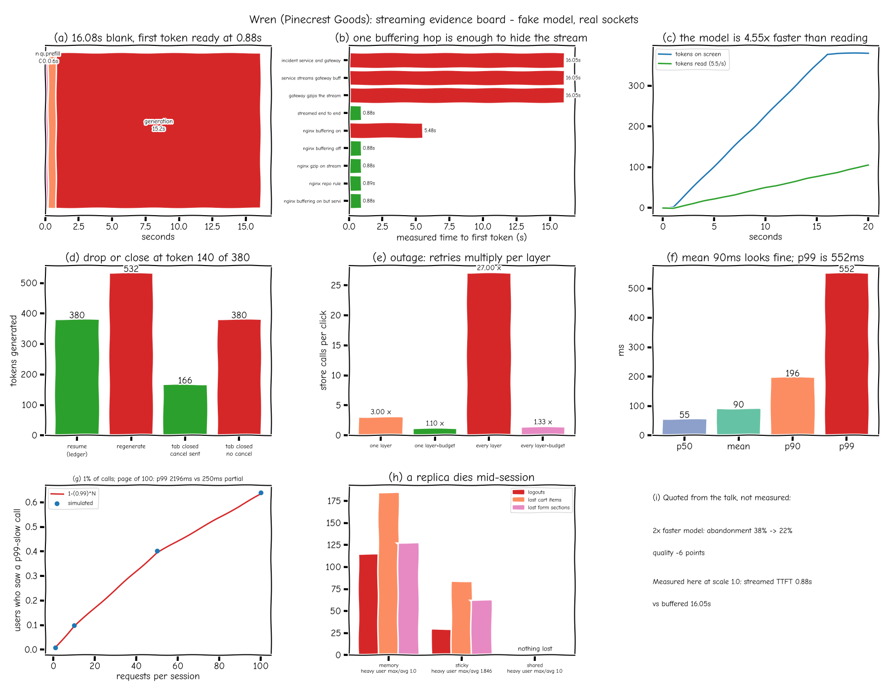
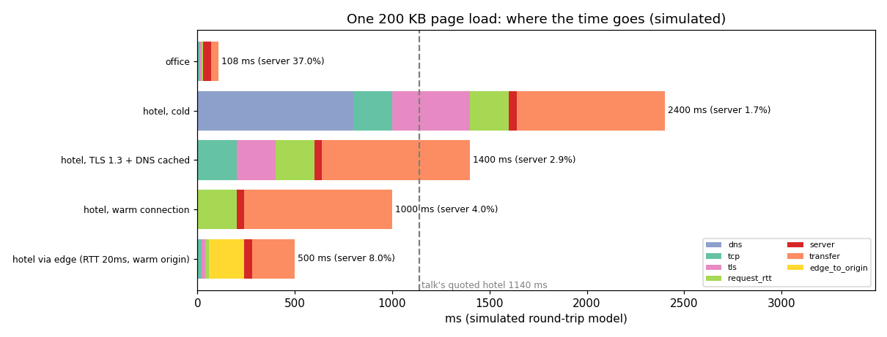

# Dashboards and evidence boards: one guide

Every evidence board in the portfolio, in one place. Each board is a single picture that tells the story of one incident or one talk: what broke, how big it was, and what the fix changed. All numbers below are copied from the committed results files named in each section. Nothing is rounded up or invented. Companies, stores and customers are fictional.

## Index

| Board | Repo | Status | What it shows |
|---|---|---|---|
| [Caching (talk 15)](#1-caching-board-talk-15) | this repo, `docs/img/evidence_board.png` | Merged | Why input tokens drove the bill, and how prompt order unlocks the prefix cache |
| [Tail latency (talk 16)](#2-tail-latency-board-talk-16) | this repo, `docs/img/tail_evidence_board.png` | Merged | How a 1% slow call grows with fan-out, and the deadline budget that caps it |
| [Streaming (talk 17)](#3-streaming-board-talk-17) | this repo, `docs/img/stream_evidence_board.png` | Merged (PR #14) | Buffering hops, resume, retries, percentiles, stateless replicas |
| [Talk 18 board](#4-talk-18-board) | this repo, `docs/img/talk18_evidence_board.png` | Merged (PR #15) | Silent wrong answers, page-load waterfall, event loop vs processes |
| [Network waterfall (talk 18)](#5-network-waterfall-talk-18) | this repo, `docs/img/network_waterfall.png` | Merged (PR #15) | Where the time goes in one page load, per network path |
| [Token accounting](#6-token-accounting-board) | [Jagadish-token-accounting](https://github.com/jagadishmazure-jpg/Jagadish-token-accounting/blob/main/docs/charts/evidence_board.png) | Merged | Real tokenizer counts, quick-rule error, where input tokens go |

Related charts that are single plots, not boards, are listed at the end.

## How to read any board

1. **Read the title first.** It names the fictional company and says whether the numbers are simulated, measured or mixed.
2. **Panels go left to right, top to bottom, in story order:** the symptom, then the cause, then the fix.
3. **Check the label on every number.** *Simulated* means a seeded offline model (repeatable, not a real service). *Measured* means a real run on one machine (8 CPUs, Python 3.13.5 where stated); your numbers will differ. *Quoted* means a figure from the source talk, shown only for comparison.
4. **Compare before vs after inside one panel,** not across boards. Each board has its own scale.
5. **Trust the JSON over the PNG.** Every board is drawn from a results file. CI re-runs the board scripts with `--check` and fails if the numbers drift, so the JSON is the source of truth. PNG bytes differ by font and platform.

---

## 1. Caching board (talk 15)

- **For:** the talk on caching for LLM apps. Incident: Kestrel, a support assistant for the fictional Tidewell storefronts, saw its bill climb while traffic stayed flat. Full write-up: [caching.md](caching.md).
- **Numbers:** simulated incident replay with illustrative prices (input $2.50, output $10.00 per 1M tokens, cached input at 10%). Source: `docs/results/evidence_board.json`. Timeline months other than June and August are story points, not measurements.

| Panel | How to read it | Key numbers |
|---|---|---|
| (a) input tokens per turn | Stacked bar of what fills one prompt | system prompt 4,200, retrieved docs 1,800, history 565.2, user message and format 75 |
| (b) $ per turn | Input vs output cost per turn | input $0.0166, output $0.0038; input is 81% of the cost, 4.37x output |
| (c) tokens per turn over nine months | Line that shows slow growth, then a jump | 1,200 in Jan, 1,730 in Jun (policies), 4,800 in Jul (bigger system prompt), 6,640 in Aug (more retrieval) |
| (d) the number that doesn't add up | The same static tokens re-sent every turn | 4,200 static tokens x 200,000 turns/day = 840M identical tokens/day; $2,100/day re-sent vs $210/day if cached |

- **After the fix** (stable content first, timestamp last), the same JSON records: 4,517.3 cached tokens per turn, input cost $0.00644 per turn, median first-token time 0.826s to 0.454s, monthly bill $118,553 to $63,173 (simulated).
- **Takeaway:** the prefix cache only reuses a prompt that starts with exactly the same tokens. One timestamp on line one made every prompt new.
- **Regenerate:** `python scripts/caching_bench.py && python scripts/evidence_board.py` (CI: `--check` on both).
- **Interviews:** start a cost question by splitting input from output tokens, then ask what is identical between requests. Order the prompt from never-changes to changes-most.
- **Note:** there is no separate "after" board image. The after-fix numbers are stored in the `after` block of the JSON and in caching.md, not drawn as a second PNG.

## 2. Tail latency board (talk 16)

- **For:** the talk on tail latency and resilience. Same fictional Kestrel assistant. Write-up: [tail-latency.md](tail-latency.md).
- **Numbers:** simulated, virtual time, seeded. Source: `docs/results/tail_evidence_board.json`.

| Panel | How to read it | Key numbers |
|---|---|---|
| (a) a 1% problem grows with every call | Formula line vs simulated points, chance a request touches a slow call | 1 call: 1%; 10 calls: 9.56% (sim 9.38%); 100 calls: 63.4% (sim 63.3%) |
| (b) turn latency | p50/p99 per setup; title shows the hedging cost | healthy p99 4.716s; incident p99 10.236s; parallel only 9.83s; full fix 4.319s with 0 deadline misses; hedging adds 4.19% calls |
| (c) Little's law | Busy workers over time after a brownout at 10s | one replica saturates 14.5s after the brownout, two replicas 29.9s, fixed setup never; 200 in flight at a 30s timeout, 800 with 3 retries |
| (d) deadline slices | Each step owns a slice of the budget | session 0.5s, parallel 2.5s, model 12.0s, output moderation 1.5s, reserve 3.5s |

- **Takeaway:** the average hides the tail. Fan-out multiplies rare slowness, and long timeouts plus retries fill every worker.
- **Regenerate:** `python scripts/tail_latency_bench.py && python scripts/tail_evidence_board.py`.
- **Interviews:** say "p99 of the page, not of one call", then name the budget per step, hedging cost, and a fallback ladder.

## 3. Streaming board (talk 17)

- **For:** the talk on streaming through every hop, plus the retries, percentiles and stateless-session talks. Fictional Wren assistant for Pinecrest Goods. Write-up: [streaming.md](streaming.md).
- **Numbers:** mixed. First-token times, drop and cancel rows are **measured** with real sockets and real nginx but a fake model (`docs/results/stream_replay.json`). Retries, percentiles and replica rows are **simulated** (`docs/results/talk17.json`). Two inputs are **quoted** from the talk and labelled so. Board data: `docs/results/stream_evidence_board.json`.

| Panel | How to read it | Key numbers |
|---|---|---|
| (a) blank screen breakdown | Where the 16s of blank screen comes from | network 0.08s, queue 0.2s, prefill 0.6s, generation 15.2s; buffered 16.08s vs first token 0.88s |
| (b) one buffering hop is enough | Measured first-token time per proxy setup | buffered paths about 16.05s; streamed end to end 0.8838s; real nginx with buffering on 5.4838s, off 0.8841s |
| (c) model vs reader | Tokens shown vs tokens a person has read | model is 4.55x faster than reading |
| (d) drop or close at token 140 of 380 | Tokens generated after a drop, and after a closed tab | resume from ledger 380 vs regenerate 532; cancel passed upstream 166 vs not passed 380 |
| (e) outage: retries multiply | Calls per click when the backend is down | one layer 3, all layers 27; with a 10% budget 1.1 and 1.329 |
| (f) mean vs p99 | Latency histogram, 100,000 samples | mean 90ms, p50 55ms, p99 551.5ms; 30.78% slower than the mean (quoted talk values: 90 / 55 / 543) |
| (g) page of 100 calls | Wait-for-all vs partial render at a 250ms deadline | wait for all p99 2,196.2ms; partial p99 250ms |
| (h) a replica dies mid-session | Losses per session store | memory: 114 logouts, 184 lost cart items; sticky: 29 and 83; shared store: 0 and 0 |

- **Takeaway:** every hop must pass bytes through unbuffered, a resume ledger beats regeneration, retries need one budget, and session state belongs in a shared store.
- **Regenerate:** `python scripts/stream_replay.py && python scripts/talk17_bench.py && python scripts/stream_evidence_board.py`.
- **Interviews:** list each hop (service, gateway, CDN, browser) and the setting that buffers or compresses there. Mention Last-Event-ID resume and cancel propagation.

## 4. Talk 18 board

- **For:** talk 18: silent wrong answers, the network waterfall, and concurrency vs parallelism. Write-ups: [silent-failures.md](silent-failures.md), [network-waterfall.md](network-waterfall.md), [concurrency.md](concurrency.md).
- **Numbers:** panels (a) and (b) are **simulated** (`docs/results/talk18.json`, fictional store and policies). Panels (c) and (d) are **measured** on one machine, 8 CPUs, Python 3.13.5, GIL on (`docs/results/talk18_measured.json`).

| Panel | How to read it | Key numbers |
|---|---|---|
| (a) 400 answers: ops green, quality red | HTTP errors vs wrong answers sent, by fix | before: 0 HTTP errors, yet 304 stale, 31 made-up, 12 unsafe answers sent; verifier only: 0 sent, 313 to review (78%); dated retrieval + verifier: 0 sent, 42 to review (10.5%) |
| (b) page load | Stacked phases per path; the server is the thin red slice | see section 5 |
| (c) loop stall | Worst heartbeat stall, log scale | idle 0.3ms; 100 uploads on the loop 2,960.4ms; process pool 5.8ms; throughput 33.7 to 213.1 jobs/s |
| (d) waiting vs CPU work | Seconds per method | 5,000 sleeps: threads 1.037s, asyncio 0.073s; 150 prime jobs: serial 1.496s, threads 1.542s, asyncio 1.53s, 8 processes 0.24s (6.24x) |

- **Takeaway:** an ops dashboard can be fully green while answers are wrong, so quality needs its own view. For waiting, use async; for CPU work, only processes help under the GIL.
- **Regenerate:** `python scripts/talk18_bench.py && python scripts/talk18_evidence_board.py` (measured file: `python scripts/talk18_bench.py --measure`, slow and machine-specific).
- **Interviews:** ask "who tells us an answer is wrong?" and "is this work waiting or computing?" before picking threads, async or processes.

## 5. Network waterfall (talk 18)

- **For:** the network part of talk 18. **Simulated** round-trip model, virtual clock, 200 KB page, 40ms server time, initial window of 10 packets.

| Path | Total | Notes |
|---|---|---|
| office | 108ms | server is 37% of the time |
| hotel, cold | 2,400ms | DNS 800, TCP 200, TLS 1.2 400, request 200, transfer 760; server is 1.7% |
| hotel, TLS 1.3 + DNS cached | 1,400ms | one TLS round trip, no DNS |
| hotel, warm connection | 1,000ms | only the request round trip |
| hotel via edge (20ms RTT, warm origin) | 500ms | short round trips to a nearby edge |

- **Measured check:** through a local 100ms delay proxy, a TLS 1.2 handshake took 204.4ms and TLS 1.3 took 102.6ms (`talk18_measured.json`).
- **Takeaway:** on a slow network, round trips dominate and the server is a thin slice; reuse connections and move them closer.
- **Regenerate:** drawn by the same `python scripts/talk18_evidence_board.py` run.
- **Interviews:** draw the waterfall (DNS, TCP, TLS, request, transfer) before touching the server.

## 6. Token accounting board

Lives in another repo: [evidence_board.png](https://github.com/jagadishmazure-jpg/Jagadish-token-accounting/blob/main/docs/charts/evidence_board.png) ([results.md](https://github.com/jagadishmazure-jpg/Jagadish-token-accounting/blob/main/docs/results.md)).

- **For:** counting tokens with real tokenizers end to end. **Measured** with real tokenizers (cl100k, o200k, SentencePiece, a BPE built from scratch) and a local model; output lengths in the gateway replay are simulated and prices are illustrative.

| Panel | How to read it | Key numbers |
|---|---|---|
| tokens per word | Bars per tokenizer and content type | o200k: English 1.16, Telugu 2.483; cl100k Telugu 11.81 |
| quick-rule error vs o200k | Signed % error of "4 chars/token" and "1.3 tokens/word" | 4 chars/token: English +37.6%, JSON -29.9%; 1.3 tokens/word: JSON -62.4% |
| where the tokens go | Share of a 426-token RAG request | tools 38.26%, docs 36.38%, system 9.39% |
| replay and reconciliation text | Gateway outcomes and local model drift | 1,200 requests (trim mode): ok 782, rate limited 104, over budget 314; own tokenizer + template matches the model's reported count (0.0% drift) |

- **Takeaway:** quick rules are off by tens of percent outside English; count with the model's own tokenizer and template.
- **Regenerate:** in that repo, `pip install -e ".[dev,charts]" && tokacct chart`.
- **Interviews:** budgets and rate limits must count tokens the way the provider bills them.

## Other charts (single plots, not boards)

- Token accounting: [tokens per word](https://github.com/jagadishmazure-jpg/Jagadish-token-accounting/blob/main/docs/charts/tokens_per_word.png), [quick-rule error](https://github.com/jagadishmazure-jpg/Jagadish-token-accounting/blob/main/docs/charts/estimate_error.png) (the same data as the top two board panels).
- Capacity planning: seven SVG charts in [Jagadish-llm-capacity-planning/docs/charts](https://github.com/jagadishmazure-jpg/Jagadish-llm-capacity-planning/tree/main/docs/charts) (token histograms per workload, chat p99 by scenario, bill multiplier by contract share). That repo has no combined evidence board; its own docs explain each chart.
- Grafana: `deploy/grafana/provisioning/dashboards/kestrel.json` is a live-ops dashboard definition for the local stack, not a picture with results.
