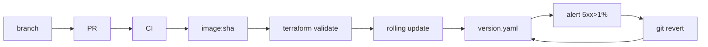

# DevOps journey: one line of code from laptop to production and back

This follows a one-line fix (the refund policy window changes from 30 to 45 days) through every stage. Each stage lists the problem it solves, the tool used here, and the alternatives.

Why bother? Picture a firm that deploys by hand to eight servers and misses one. For hours, one request in eight runs old code. Nobody can reproduce the bug, and the logs disagree with each other. Every stage below takes a human step out of that path.

## 1. Branch
- **Problem:** two people editing `main` at once, with no record of why something changed.
- **Here:** a feature branch per change. `main` is protected by two rulesets: no force-push or deletion, and the CI checks must pass.
- **Alternatives:** trunk-based development with feature flags, or GitFlow (heavier).

## 2. Pull request
- **Problem:** changes nobody reviewed, and a fix that silently breaks a test.
- **Here:** a PR with required checks: `lint-and-test`, `iac-validate` and `image-and-kind-rollout`.
- **Alternatives:** Gerrit-style patch review, pair programming as the review.

## 3. CI
- **Problem:** "works on my machine".
- **Here:** `.github/workflows/ci.yml` runs ruff, pytest (with a real Redis service), the test count, `render_docs --check`, the brand check, the eval gate, the ci-scale load test, and the estimator. Actions are pinned to full SHAs. gitleaks and CodeQL run as separate workflows.
- **Alternatives:** GitLab CI, Jenkins, Buildkite.

## 4. Image
- **Problem:** servers that drift apart because each was set up by hand.
- **Here:** a `Dockerfile` (python slim, non-root user 10001). CI builds `kestrel-api:<git sha>`, so every running pod maps to exactly one commit. `/version` reports `git_sha`. Pushing to GHCR is **planned**: CI builds the image and loads it into kind only.
- **Alternatives:** Buildpacks, ko, Nix images.

## 5. Infrastructure as code
- **Problem:** a network or database created by clicking around, which nobody can rebuild.
- **Here:** `terraform/` (azurerm) and `infra/main.bicep` describe the same layout: a VNet with edge/app/data subnets, an NSG that lets only the app subnet reach the data ports, AKS, private Postgres, Redis and Storage. CI runs `fmt -check`, `init -backend=false`, `validate` and `bicep build`. It never runs plan or apply, and it uses no credentials. **Applying costs money and needs Jagadish's yes.**
- **Alternatives:** Pulumi, OpenTofu, Crossplane.

## 6. Kubernetes rolling update
- **Problem:** a deploy that takes capacity away, or sends traffic to a pod that isn't ready.
- **Here:** `k8s/deployment.yaml` uses 3 replicas with `RollingUpdate maxUnavailable: 0, maxSurge: 1`. The readiness probe hits `/readyz`, which returns 503 when config is broken. The liveness probe hits `/healthz`. A `preStop` sleep lets endpoints drain.
- **Proof (real kind cluster in CI):** `scripts/kind_rollout.sh` starts an in-cluster load loop against the Service. It rolls v1 → v2 and asserts **zero failed requests**. It then rolls a broken v3 (`APP_BROKEN_CONFIG=1`). The rollout must halt, v3 must serve 0 requests, and v2 keeps serving with zero failures. The numbers are in `loadtest/results/k8s_rollout.json`, copied from the CI artifact. Recorded run (image `3ad781097f0c`): v1 → v2 took 7.7 s, with 2,023 requests and 0 failed (465 v1, 1,558 v2). Broken v3: rollout halted, 3 v2 pods ready throughout, 1,801 requests, 0 failed, 0 served by v3.
- **Alternatives:** blue/green, canary with Argo Rollouts or Flagger.

## 7. GitOps
- **Problem:** "what is actually deployed?" having no single answer.
- **Here:** `deploy/version.yaml` is the desired state. An Argo CD `Application` that syncs `k8s/` from `main` is in `deploy/argocd/application.yaml`. It is **planned**, not installed.
- **Alternatives:** Flux, a push-based CD job.

## 8. Observability
- **Problem:** finding out about an outage from customers.
- **Here:** every response increments `sd_http_requests_total{route,status}`, including 401s and 429s returned by the gateway. Prometheus loads `deploy/alerts.yml`, where `HighErrorRate` fires when 5xx is above 1% for 5 minutes. The code rule in `sysdesign/ext/release.py` uses the same 1% threshold plus a minimum of 50 requests per window. A test checks that every metric the alerts and the dashboard use is actually exported. Grafana (`docker compose --profile observability up`) provisions a dashboard showing error rate, p95, cost, cache hit rate and 429s. The Grafana profile is written but has not been run.
- **Alternatives:** Datadog, the OpenTelemetry Collector into any backend (an OTel config is included).

## 9. Rollback
- **Problem:** a bad release at 3 a.m. and a manual, error-prone undo.
- **Here:** rollback means `git revert` of the commit that changed `deploy/version.yaml`. `sysdesign/ext/release.py::on_alert_revert` does this when the error-rate rule fires (tested in `test_alert_after_release_triggers_git_revert`). `scripts/gitops_rollback.sh --apply` demos it on kind. Within the cluster, `kubectl rollout undo` is the fast path that `kind_rollout.sh` uses after the v3 stall.
- **Alternatives:** feature-flag kill switches, re-deploying the previous image tag.

