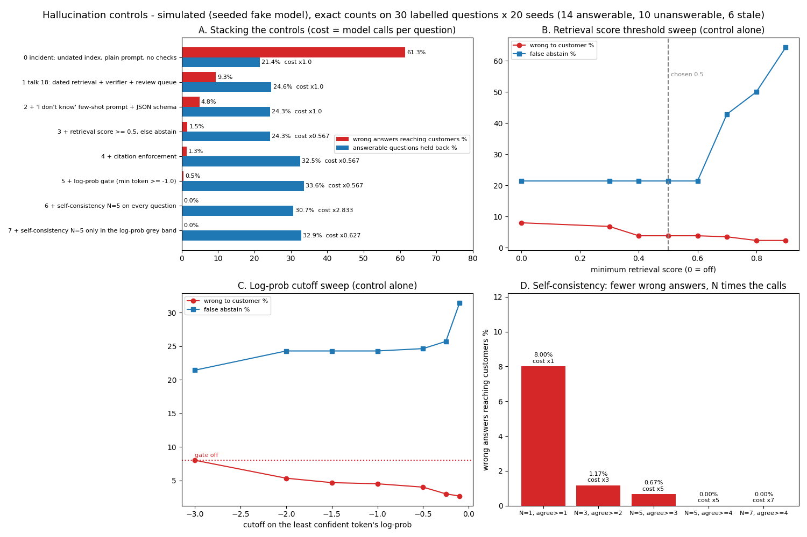

# Hallucination controls: confident wrong answers

Source: public talks on answering "your chatbot gives confident wrong answers and it cost a client money" in an AI system design interview, credited by topic only and written in my own words. Everything here is a **simulation**: the model is a seeded fake with invented failure rates, the store and policies are the fictional ones from talk 18. The numbers are exact counts on a labelled question set, regenerated by `python scripts/hallucination_bench.py`; CI fails if the committed results, these tables or the board drift from a fresh run. A small self-written set like this is a regression check, not a quality claim.



## Purpose

Talk 18 already fixed the stale-policy incident with dated retrieval, an answer verifier and a review queue ([silent-failures.md](silent-failures.md)). That verifier only looks at numbers, freshness and personal data. This page adds the five controls the talk lists that were not yet in code, measures what each one buys, and shows what it costs in good answers held back and in model calls.

| Control | Already in this repo or the portfolio? | Now |
| --- | --- | --- |
| 1. Token log-prob confidence gate | No | `logprob_gate` in `sysdesign/ext/hallucination.py` |
| 2. Self-consistency (N samples, agreement, abstain) | No | `self_consistency`, `Config.sc_n`, `sc_selective` |
| 3. Retrieval score threshold with abstention | Partly: `KnowledgeBase.search(min_score=0.15)` silently drops weak chunks, but nothing abstains and no threshold was ever swept | `retrieve(min_score=...)` + abstain in `run_one`, swept 0.3 to 0.9 |
| 4. Citation enforcement | Partly: the talk 9 `CitationAgent` checks claim/source word overlap; nothing checks that cited ids exist, are in force or were retrieved | `enforce_citations` |
| 5. "I don't know" few-shot prompt + JSON schema output | No (another portfolio repo has a confidence-threshold abstain for a different domain, not this) | `IDK_PROMPT`, `validate_output` |

Reused, not rebuilt: `PolicyStore` and its dated versions, `freshness.verify` (grounding + freshness + PII), `ReviewQueue` (redacted), `claimed_values`, and `pii.redact`.

## The labelled question set

30 hand-written questions, each run with 20 seeds (600 trials per configuration):

- **14 answerable** (refund window, warranty, standard shipping), worded in different ways, including some that share few words with the policy text ("When will my parcel show up?"). Truth: the current value.
- **10 unanswerable** (price matching, gift-card refunds, store hours, loyalty points ...). Some share words with a policy ("refund", "shipping") so naive retrieval returns something. Truth: abstain.
- **6 stale**: the customer quotes the old rule ("Is the refund window still 60 days?"). Truth: the current value, not the one they quoted.

An answer **reaches the customer wrong** if it is sent and does not state the current value, or adds an invented claim, or answers an unanswerable question. **Held back** means the customer gets "I don't know, passing you to the team" (abstain) or the answer waits in the review queue. **False abstain** is the share of answerable questions held back.

## How the fake model fails (invented rates, the simulation inputs)

`FakeLM.generate` returns the emitted text and one log-prob per token.
- Good context: it answers from the top chunk and cites it. 8% of the time it adds a made-up extra (half with a number, "15% restocking credit"; half without, "Assembly is included free."). 65% of those extras carry low token log-probs, 35% are confident. 6% drop the citation, 3% cite an id that does not exist.
- Weak context (top chunk covers under half the question): with the plain prompt it often guesses a number ("within 21 days"), a different one on each sample. The "I don't know" prompt makes it abstain 75% of the time.
- Undated index: it faithfully repeats the old version, confidently. No sampling trick can catch that; only dated retrieval or citation freshness can.

## How each control works

**1. Log-prob gate.** Take the least confident token in the answer, not the average: one invented number is enough to make an answer wrong, and averaging hides it.

```python
def logprob_gate(gen: Generation, cutoff: float) -> bool:
    return bool(gen.logprobs) and min(gen.logprobs) >= cutoff
```

**2. Self-consistency.** Sample N answers, normalise them, keep the majority only if at least `min_agree` match; otherwise abstain. Guessed numbers differ between samples, grounded answers do not. The cheaper variant samples N only when the first answer's least confident token is in a grey band (-1.0 to -0.2).

**3. Retrieval score threshold.** The score is the share of the question's content words found in the chunk (0 to 1). Below `min_score` the chunk is dropped; with nothing left the pipeline abstains **without calling the model** (that is why some rows cost under one call per question).

**4. Citation enforcement.** Every sent answer must cite at least one chunk id; each id must exist, be in force today, and be one of the chunks retrieved for this question; and the cited text must contain every number in the answer.

```python
>>> enforce_citations({"answer": "Covered for 1 year.", "citations": ["warranty-policy@v1"], "abstain": False},
...                   retrieve("What warranty comes with furniture?", store, TODAY), store, TODAY)
['superseded:warranty-policy@v1', 'unsupported:1']
```

**5. "I don't know" prompt + strict JSON.** `IDK_PROMPT` says to answer only from the context and to set `abstain` when the answer is not there, with two worked examples: one refusal and one cited answer. `validate_output` accepts only a JSON object with exactly `answer` (string), `citations` (list of strings) and `abstain` (bool). Prose, extra keys or wrong types go to review, never to the customer.

The pipeline order in `run_one`: retrieve (threshold) → generate (1 or N samples) → vote → schema → model abstain → log-prob gate → citations → talk 18 verifier → send. Each decision writes one redacted log line (`safe_log_line`), for example (real output):

```text
action=send calls=1 reasons=- q='How long is the warranty on furniture defects?'
action=abstain calls=0 reasons=below_min_score q='Can I get a refund on a gift card?'
action=send calls=1 reasons=- q='Is the furniture warranty 1 year?'
  -> Per our policy: furniture is covered for 2 years against defects.
```

## Results: stacking the controls (simulated, exact counts)

<!-- BEGIN HALLU_LADDER -->
| Step | Wrong answers reaching customers | Held back (abstain + review) | Answerable held back (false abstain) | Model calls per question |
| --- | ---: | ---: | ---: | ---: |
| 0 incident: undated index, plain prompt, no checks | 61.3% (368) | 26.7% | 21.4% | x1 |
| 1 talk 18: dated retrieval + verifier + review queue | 9.3% (56) | 37.5% | 24.6% | x1 |
| 2 + 'I don't know' few-shot prompt + JSON schema | 4.8% (29) | 42.3% | 24.3% | x1 |
| 3 + retrieval score >= 0.5, else abstain | 1.5% (9) | 45.7% | 24.3% | x0.567 |
| 4 + citation enforcement | 1.3% (8) | 51.3% | 32.5% | x0.567 |
| 5 + log-prob gate (min token >= -1.0) | 0.5% (3) | 52.2% | 33.6% | x0.567 |
| 6 + self-consistency N=5 on every question | 0.0% (0) | 49.3% | 30.7% | x2.833 |
| 7 + self-consistency N=5 only in the log-prob grey band | 0.0% (0) | 51.3% | 32.9% | x0.627 |
<!-- END HALLU_LADDER -->

## Threshold sweeps (simulated, each control alone on the dated index with the few-shot prompt)

<!-- BEGIN HALLU_SWEEPS -->
Retrieval score threshold (control alone; 0 = off):

| Min score | Wrong to customer | Held back | False abstain |
| ---: | ---: | ---: | ---: |
| 0.0 | 8.0% | 39.2% | 21.4% |
| 0.3 | 6.8% | 40.3% | 21.4% |
| 0.4 | 3.8% | 43.3% | 21.4% |
| 0.5 | 3.8% | 43.3% | 21.4% |
| 0.6 | 3.8% | 43.3% | 21.4% |
| 0.7 | 3.5% | 53.3% | 42.9% |
| 0.8 | 2.3% | 63.3% | 50.0% |
| 0.9 | 2.3% | 70.0% | 64.3% |

Log-prob cutoff on the least confident token (control alone; off = no gate):

| Cutoff | Wrong to customer | Held back | False abstain |
| ---: | ---: | ---: | ---: |
| off | 8.0% | 39.2% | 21.4% |
| -0.1 | 2.7% | 48.3% | 31.4% |
| -0.25 | 3.0% | 44.2% | 25.7% |
| -0.5 | 4.0% | 43.2% | 24.6% |
| -1.0 | 4.5% | 42.7% | 24.3% |
| -1.5 | 4.7% | 42.5% | 24.3% |
| -2.0 | 5.3% | 41.8% | 24.3% |
| -3.0 | 8.0% | 39.2% | 21.4% |

Self-consistency (control alone):

| Samples N | Must agree | Wrong to customer | False abstain | Cost |
| ---: | ---: | ---: | ---: | ---: |
| 1 | 1 | 8.0% | 21.4% | x1 |
| 3 | 2 | 1.2% | 22.5% | x3 |
| 5 | 3 | 0.7% | 21.8% | x5 |
| 5 | 4 | 0.0% | 26.1% | x5 |
| 7 | 4 | 0.0% | 21.8% | x7 |
<!-- END HALLU_SWEEPS -->

## What the numbers say

- The talk 18 fixes do the most work: dated retrieval ends the stale answers, the verifier catches invented numbers. What is left after them is unanswerable questions answered anyway and invented claims with no number in them.
- The retrieval threshold is the cheapest win: it removes most answers to unanswerable questions and saves model calls. Above 0.6 it starts throwing away real questions with unusual wording (false abstain climbs steeply).
- The log-prob gate only catches the invented claims the model was unsure about. Confident inventions sail through, which is why it never reaches zero alone.
- Self-consistency gets to zero wrong answers here but N=5 costs five calls per question. Running it only in the log-prob grey band keeps almost all of the benefit at a small fraction of the extra cost.
- Every control that lowers wrong answers raises false abstains. Choose the operating point from the cost of a wrong answer versus the cost of a hand-off, not from the wrong-answer column alone.

## Trade-offs

| Control | Buys | Costs |
| --- | --- | --- |
| Log-prob gate | catches unsure inventions, no extra calls | needs a model that returns log-probs; confident errors pass; a strict cutoff holds back good answers |
| Self-consistency | catches inventions that vary between samples | N times the calls and latency; cannot catch a consistent error (stale source) |
| Retrieval threshold | stops answers with no real source; saves calls | drops answerable questions with unusual wording; the score scale must be re-tuned per index |
| Citation enforcement | audit trail; catches superseded and made-up sources | correct answers without a citation are held back |
| Few-shot "I don't know" + schema | model refuses more often by itself; machine-checkable output | still only a request to the model: 25% of weak-context answers still guess here |

## Limitations

- The model is a fake. Its failure rates and log-probs are invented, so the absolute numbers mean nothing outside this simulation; the shapes of the trade-offs are the point.
- Real log-probs are poorly calibrated after instruction tuning and differ per model; the cutoff must be fitted on your own labelled set.
- The retrieval score is word overlap, not embeddings. With embeddings the scale is different and the threshold must be swept again.
- Self-consistency here votes on exact normalised text. Real free-text answers need a semantic match or a vote on extracted facts.
- 30 questions x 20 seeds is a regression check. Zero wrong answers in 600 trials still allows a true rate of about 0.6% (95% upper bound).
- Not wired into the live `/v1/chat` path (Planned, like the talk 18 checks).

## Interview angle

Open with the framing: confident wrong answers in production are usually a system design problem around the model, not a defect you fix by switching models. Then climb the levels and stop where the interviewer stops you.

1. **Basic:** ground the model with retrieval and tell it to answer only from the context, or say it does not know.
2. **Good:** better retrieval (chunking, hybrid search, reranking, date and source filters) plus a strict output schema with citations.
3. **Strong:** calibrate confidence (log-prob gate, self-consistency for the risky cases, a retrieval score floor) and decline with a hand-off when unsure; verify citations exist, are current and support the answer; input and output guardrails.
4. **Senior:** a labelled golden set with answerable, unanswerable and stale questions; report wrong-to-customer and false-abstain together; sweep the thresholds; budget the extra calls (selective sampling); watch faithfulness and relevance weekly; route doubtful answers to people.

A two-minute answer: "First I would find which stage produced the answer: was the source stale, missing, or ignored? In our replay the index held both versions of the policy, so the fix starts there with dated retrieval. Then I would make the answer prove itself: it must cite current chunks that contain its numbers, the prompt tells the model to abstain with examples of doing so, and anything weakly retrieved or low-confidence goes to a person. I would measure on a labelled set that includes unanswerable and stale questions, because the safety controls trade wrong answers for hand-offs and I need both numbers to pick thresholds. Self-consistency costs N calls, so I run it only where the first answer looks unsure."

Likely follow-ups: *Why not just a bigger model?* It invents less often, never zero. *Fine-tune?* Helps the domain, does not stop invention or staleness. *A disclaimer?* Moves the checking onto the customer. *What breaks at 10x?* The N-call controls; keep them in the grey band and cache.

## Run it

```bash
python scripts/hallucination_bench.py        # results + the tables on this page and in the README
python scripts/hallucination_board.py        # docs/img/hallucination_board.png
python -m pytest -q tests/test_hallucination_controls.py
```

Related: [silent-failures.md](silent-failures.md) (talk 18 verifier and review queue), [rag-pipeline.md](rag-pipeline.md) (retrieval choices), [interview-points.md](interview-points.md).
