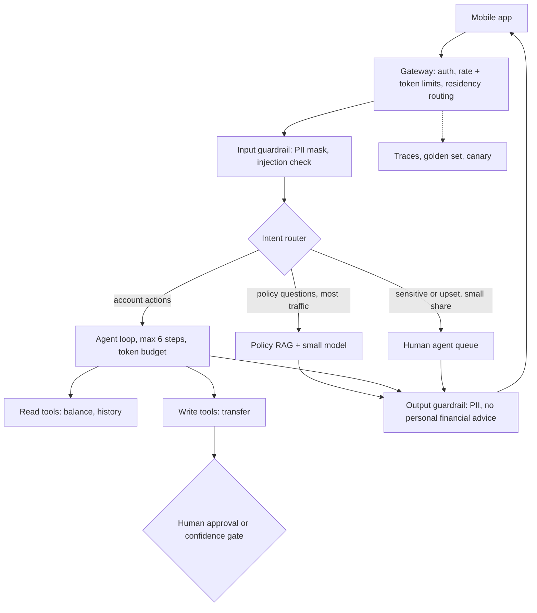

# Case 1: Northwind Ledger Bank customer assistant

**Prompt:** "Design an assistant for a retail bank's app." (Fictional bank.)

## Clarify (assumed answers)

| Question | Assumed answer | Drives |
|---|---|---|
| Users and frequency? | 2M active users, one conversation every other day, about six turns | Cache common policy answers; three routing tiers |
| How fast must it feel? | First token under 1 s; full answer in a few seconds | Streaming; small model on the policy path |
| Knowledge freshness? | Fees and policies change weekly | RAG with a nightly reindex; no fine-tuning for facts |
| Cost of one error? | High for money movement, regulatory for advice | Human or confidence gate on writes; abstain; advice guardrail |
| Budget? | $0.02 per conversation; account-action conversations may spend $0.04 | Routing mix and agent step cap |
| Functional | Chat, balance and transaction lookups, transfers, feedback thumbs, hand-off to an agent | |
| Non-functional | 99.9% availability, data stays in-country, full audit trail | |

## Envelope

<!-- envelope:case:bank -->
| Quantity | Value |
|---|---|
| Conversations per day | 1M |
| Model requests per day | 6M |
| Average QPS (requests / 86,400) | 69.4 |
| Peak QPS (x3) | 208 |
| Tokens per request (system + context + output) | 600 + 1,800 + 300 = 2,700 |
| Input tokens per day | 14.4B |
| Output tokens per day | 1.8B |
| Tokens per day | 16.2B |
| Cost per day at 75% small / 20% mid / 5% frontier | $12,150 |
| Cost per day if everything went to frontier | $108,000 |
| Cost per conversation | $0.0121 |
| Target per conversation | $0.02 |
| Meets target at the starting mix? | yes |
| Best-quality mix that fits (frontier >= 5%) | 35% small / 60% mid / 5% frontier = $0.0195 |
| Cheapest feasible mix | 95% small / 0% mid / 5% frontier = $0.008478 |
| 10x users: peak QPS | 2,083 |
| 10x users with 30% cache hits: model peak QPS | 1,458 |
| 10x users with 30% cache hits: cost per day | $85,050 |
| Agent step cap ($0.04 budget, 5,000 in + 400 out per step, mid) | 6 |
<!-- /envelope:case:bank -->

The step cap is computed, not guessed: a worst-case agent step on the mid tier costs about a sixth of the action budget, so six steps is the ceiling.

## High-level design

**User flow:** sign in, ask, see a streamed answer or an action preview, confirm, rate. **Data flow:** app → in-country gateway → router → in-country vector store and core-banking APIs → guardrail → app. Residency means storage (logs, vectors, transcripts) stays in-country; a transit requirement also pins inference in-country, so the router must only pick in-region model endpoints.

## Deep dive

- **Router:** rules first (keywords like "transfer"), then a small classifier, then a fallback to the mid tier. Repo: `sysdesign/router.py`.
- **Agent loop:** read tools run without approval; a write tool returns a preview and waits for the customer plus a policy check; amounts over a threshold or confidence below it go to a human. Idempotency keys stop double transfers on retry (`tests/test_queue_workflow.py`).
- **Guardrails:** PII redaction before logging (`sysdesign/pii.py`), and an output rule that refuses personalised investment advice and points to a licensed adviser.

## Trade-offs

More small-tier traffic lowers cost but raises the wrong-answer rate on edge policies; the mid share in the best mix is the quality buffer. Human gates are safe but cost staff time and add minutes of latency.

## Failure modes

Retriever returns an outdated fee page (fix: reindex on change, cite the source date). Agent loops on a failing tool (fix: step cap plus a budget stop). Model provider outage (fix: breaker and fallback tier, `sysdesign/resilience.py`).

## 10x follow-up

See the 10x rows above: QPS and spend scale linearly, so quota and spend break first. Policy answers are highly repetitive, so the response cache is the first lever, then shifting more traffic to the small tier with the golden set as the guard.

## Wrap-up

Name your own risks: a customer pasting an account number into chat, a prompt injection inside a retrieved document, and a regulator asking why a transfer was approved (answer: the trace and approval record).
