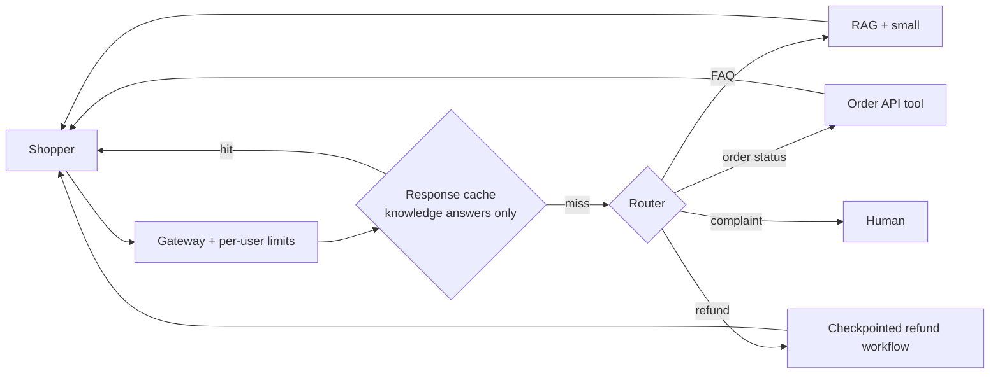

# Case 2: Brightcart retail support assistant

**Prompt:** "Design customer support chat for an online store." (Fictional retailer.) This repo's base build is exactly this kind of assistant, so the case leans on existing talks: [caching.md](../caching.md) (talk 15), [tail-latency.md](../tail-latency.md) (talk 16) and the router and refund workflow in main.

## Clarify (assumed answers)

| Question | Assumed answer | Drives |
|---|---|---|
| Users and frequency? | 1.5M users, a chat for 40% of them per day at sale peaks, five turns | Heavy caching of shipping and return answers |
| How fast? | First token under 800 ms | Streaming, small tier for FAQ |
| Freshness? | Order status is live; policies change monthly | Live order API tool, RAG for policy, never cache order data |
| Cost of an error? | A wrong refund costs money; a wrong FAQ answer costs a ticket | Refunds through an idempotent checkpointed workflow |
| Budget? | $0.01 per conversation | Small-heavy mix |

## Envelope

<!-- envelope:case:retail -->
| Quantity | Value |
|---|---|
| Conversations per day | 600k |
| Model requests per day | 3M |
| Average QPS (requests / 86,400) | 34.7 |
| Peak QPS (x3) | 104 |
| Tokens per request (system + context + output) | 500 + 1,500 + 250 = 2,250 |
| Input tokens per day | 6B |
| Output tokens per day | 750M |
| Tokens per day | 6.75B |
| Cost per day at 75% small / 20% mid / 5% frontier | $5,063 |
| Cost per day if everything went to frontier | $45,000 |
| Cost per conversation | $0.008438 |
| Target per conversation | $0.01 |
| Meets target at the starting mix? | yes |
| Best-quality mix that fits (frontier >= 0%) | 40% small / 60% mid / 0% frontier = $0.0099 |
| Cheapest feasible mix | 100% small / 0% mid / 0% frontier = $0.00225 |
| 10x users: peak QPS | 1,042 |
| 10x users with 30% cache hits: model peak QPS | 729 |
| 10x users with 30% cache hits: cost per day | $35,438 |
<!-- /envelope:case:retail -->

## High-level design

## Deep dive

Prompt order for prefix caching (stable system prompt first, volatile data last) and the response cache keyed by tenant and permissions: `tests/test_talk15_caching.py`. Refund exactly-once after a pod dies: `tests/test_queue_workflow.py`.

## Trade-offs

Aggressive caching cuts cost and latency but risks stale answers; invalidate on content change (CDC) rather than with long TTLs.

## Failure modes

A timestamp at the start of the prompt that defeats the provider prefix cache (talk 15 replay); a slow moderation dependency inflating p99 (talk 16 replay).

## 10x follow-up

Sale-day traffic is the real 10x. Queue refunds, shed low-priority work with admission control (`sysdesign/admission.py`), and lean on the cache rows above.

## Wrap-up

Raise: fraudsters probing refund rules, and shoppers pasting card numbers (PII masking before logs).
