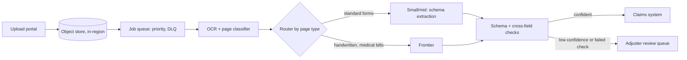

# Case 3: Harborline Mutual claims document extraction

**Prompt:** "Design a system that extracts fields from insurance claim documents." (Fictional insurer.)

## Clarify (assumed answers)

| Question | Assumed answer | Drives |
|---|---|---|
| Volume? | 40k claims a day, about 12 page-chunks each, heavy Monday mornings (peak x4) | Async queue, batch workers |
| How fast? | Minutes, not seconds; adjusters see results the same hour | No streaming; batch for throughput |
| Freshness? | Forms change a few times a year | Versioned extraction schemas, not fine-tuning |
| Cost of an error? | Wrong payout amount or missed exclusion: real money and regulatory | Schema validation, confidence per field, human review queue |
| Budget? | $0.25 per claim | Room for a larger frontier share on hard pages |

## Envelope

<!-- envelope:case:insurance -->
| Quantity | Value |
|---|---|
| Conversations per day | 40k |
| Model requests per day | 480k |
| Average QPS (requests / 86,400) | 5.6 |
| Peak QPS (x4) | 22.2 |
| Tokens per request (system + context + output) | 400 + 6,000 + 600 = 7,000 |
| Input tokens per day | 3.07B |
| Output tokens per day | 288M |
| Tokens per day | 3.36B |
| Cost per day at 75% small / 20% mid / 5% frontier | $2,376 |
| Cost per day if everything went to frontier | $21,120 |
| Cost per conversation | $0.0594 |
| Target per conversation | $0.25 |
| Meets target at the starting mix? | yes |
| Best-quality mix that fits (frontier >= 10%) | 0% small / 70% mid / 30% frontier = $0.2323 |
| Cheapest feasible mix | 90% small / 0% mid / 10% frontier = $0.0671 |
| 10x users: peak QPS | 222 |
| 10x users with 30% cache hits: model peak QPS | 156 |
| 10x users with 30% cache hits: cost per day | $16,632 |
<!-- /envelope:case:insurance -->

The budget fits a richer mix than chat, because each claim is worth far more than each chat turn.

## High-level design

## Deep dive

One schema source with extra keys and NaN rejected; one or two repair retries then escalate; log repair and escalation rates. Cross-field checks (line items sum to the total, dates inside the policy period) catch confident-but-wrong output. Queue patterns: `sysdesign/jobqueue.py`.

## Trade-offs

A lower review threshold means fewer humans but more silent errors; tune it on a labelled golden set of past claims, per field.

## Failure modes

Scanned pages upside down, two claims merged into one PDF, a poisoned document containing instructions (treat document text as data; never let it change the tool set).

## 10x follow-up

A storm event is the 10x. The queue absorbs it; set the worker count from queue age, not CPU (`sysdesign/autoscaler.py`), and tell adjusters the expected delay.

## Wrap-up

Raise: retention and deletion of medical attachments, and an audit trail per extracted field.
