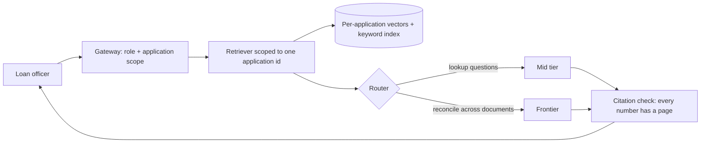

# Case 5: Keystone Home Lending mortgage document Q&A

**Prompt:** "Let loan officers ask questions about an applicant's document package." (Fictional lender.)

## Clarify (assumed answers)

| Question | Assumed answer | Drives |
|---|---|---|
| Users and frequency? | 60k application sessions a day, ten questions each | Per-application index |
| How fast? | A few seconds is fine | Mid tier acceptable |
| Freshness? | Documents arrive during the application | Index on upload; no shared corpus |
| Cost of an error? | Wrong income figure → bad lending decision | Citations to page and line; officer confirms numbers |
| Budget? | $0.20 per application session | Long context affordable |

## Envelope

<!-- envelope:case:mortgage -->
| Quantity | Value |
|---|---|
| Conversations per day | 60k |
| Model requests per day | 600k |
| Average QPS (requests / 86,400) | 6.9 |
| Peak QPS (x3) | 20.8 |
| Tokens per request (system + context + output) | 500 + 8,000 + 400 = 8,900 |
| Input tokens per day | 5.1B |
| Output tokens per day | 240M |
| Tokens per day | 5.34B |
| Cost per day at 75% small / 20% mid / 5% frontier | $3,409 |
| Cost per day if everything went to frontier | $30,300 |
| Cost per conversation | $0.0568 |
| Target per conversation | $0.2 |
| Meets target at the starting mix? | yes |
| Best-quality mix that fits (frontier >= 5%) | 0% small / 80% mid / 20% frontier = $0.1818 |
| Cheapest feasible mix | 95% small / 0% mid / 5% frontier = $0.0396 |
| 10x users: peak QPS | 208 |
| 10x users with 30% cache hits: model peak QPS | 146 |
| 10x users with 30% cache hits: cost per day | $23,861 |
<!-- /envelope:case:mortgage -->

Context dominates: 8k retrieved tokens per question, so input price matters more than output price here.

## High-level design

## Deep dive

Hybrid search (keyword for account numbers and amounts, vectors for meaning); the application id is a hard filter, so one applicant's data can never leak into another's answer. Numbers without a citation are rejected by a grounding check (`test_grounding_blocks_invented_number`).

## Trade-offs

Bigger chunks give more context but cost more input tokens; measure hit rate per chunk size (talk 6 benchmark in [rag-pipeline.md](../rag-pipeline.md)).

## Failure modes

Two pay stubs with different dates (answer with both, cited); scanned tables lost by OCR (route to frontier or human).

## 10x follow-up

Refinance waves. Indexing is the first bottleneck; queue it and show officers a "still indexing" state.

## Wrap-up

Raise: deletion after the application closes, and fair-lending review of any summary text.
