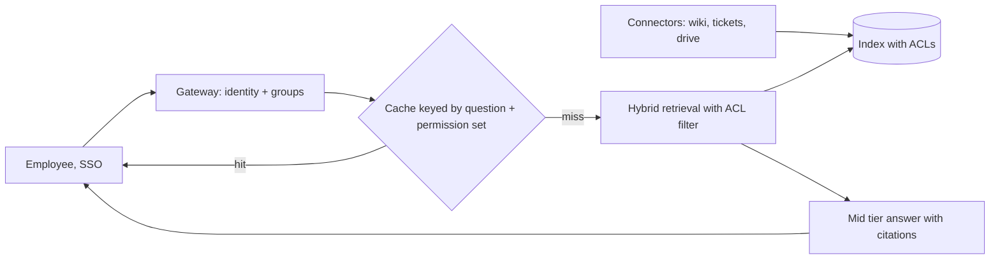

# Case 6: Fernwave Systems internal knowledge search

**Prompt:** "Build an assistant that answers employee questions from our wikis, tickets and drives." (Fictional company.)

## Clarify (assumed answers)

| Question | Assumed answer | Drives |
|---|---|---|
| Users and frequency? | 50k employees, three searches a day, two turns each; Monday 9 am spike (peak x5) | Cache popular answers per permission group |
| How fast? | Two seconds | Streaming, small/mid |
| Freshness? | Pages change hourly | Incremental reindex from change events |
| Cost of an error? | Low per answer, but a permission leak is severe | Permission filter at retrieval, not after generation |
| Budget? | $0.01 per search | Mid-heavy mix still fits |

## Envelope

<!-- envelope:case:enterprise -->
| Quantity | Value |
|---|---|
| Conversations per day | 150k |
| Model requests per day | 300k |
| Average QPS (requests / 86,400) | 3.5 |
| Peak QPS (x5) | 17.4 |
| Tokens per request (system + context + output) | 400 + 3,000 + 350 = 3,750 |
| Input tokens per day | 1.02B |
| Output tokens per day | 105M |
| Tokens per day | 1.12B |
| Cost per day at 75% small / 20% mid / 5% frontier | $810 |
| Cost per day if everything went to frontier | $7,200 |
| Cost per conversation | $0.0054 |
| Target per conversation | $0.01 |
| Meets target at the starting mix? | yes |
| Best-quality mix that fits (frontier >= 0%) | 0% small / 100% mid / 0% frontier = $0.0096 |
| Cheapest feasible mix | 100% small / 0% mid / 0% frontier = $0.00144 |
| 10x users: peak QPS | 174 |
| 10x users with 30% cache hits: model peak QPS | 122 |
| 10x users with 30% cache hits: cost per day | $5,670 |
<!-- /envelope:case:enterprise -->

At this budget even all-mid fits, so the decision is about latency and quality, not cost.

## High-level design

## Deep dive

ACLs are copied into the index and applied as a filter before ranking; caching keys include the permission set so a cached answer never crosses groups. Counting questions ("how many open incidents?") go to a structured query, not vectors (`test_vector_alone_is_wrong_for_counting`).

## Trade-offs

Per-group cache keys lower hit rate but are the price of not leaking. Hourly reindex vs event-driven: events are fresher but need connector work.

## Failure modes

A page's permissions change after indexing (fix: ACL change events invalidate entries); stale duplicates outrank the current page (boost by recency and owner).

## 10x follow-up

An acquisition doubles headcount and adds a new corpus: indexing and ACL mapping break before QPS does.

## Wrap-up

Raise: right-to-be-forgotten for departed staff's content, and measuring answer usefulness with thumbs feedback.
