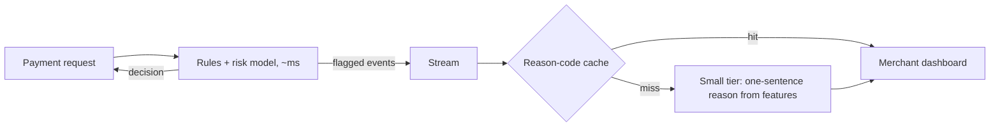

# Case 7: Quickpay Lane checkout risk notes (low latency, high frequency)

**Prompt:** "Add AI to our payment checkout so merchants see why a payment was flagged." (Fictional payment processor.)

## Clarify (assumed answers)

| Question | Assumed answer | Drives |
|---|---|---|
| Users and frequency? | 5M cardholders, about 20 payments each a day across merchants; peak x5 at lunch and evenings | Very high QPS |
| How fast? | The approve/decline decision must land in about 50 ms | No LLM on the decision path |
| Freshness? | Fraud patterns shift daily | Feature store and model retraining, not prompts |
| Cost of an error? | A false decline loses a sale; a false approve loses money | Decision stays with a scored model plus rules |
| Budget? | $0.0002 per payment for the explanation | Tiny prompts, small-heavy mix |

## Envelope

<!-- envelope:case:lowlatency -->
| Quantity | Value |
|---|---|
| Conversations per day | 100M |
| Model requests per day | 100M |
| Average QPS (requests / 86,400) | 1,157 |
| Peak QPS (x5) | 5,787 |
| Tokens per request (system + context + output) | 150 + 200 + 20 = 370 |
| Input tokens per day | 35B |
| Output tokens per day | 2B |
| Tokens per day | 37B |
| Cost per day at 75% small / 20% mid / 5% frontier | $24,188 |
| Cost per day if everything went to frontier | $215,000 |
| Cost per conversation | $0.000242 |
| Target per conversation | $0.0002 |
| Meets target at the starting mix? | no |
| Best-quality mix that fits (frontier >= 0%) | 65% small / 35% mid / 0% frontier = $0.000192 |
| Cheapest feasible mix | 100% small / 0% mid / 0% frontier = $0.000064 |
| 10x users: peak QPS | 57,870 |
| 10x users with 30% cache hits: model peak QPS | 40,509 |
| 10x users with 30% cache hits: cost per day | $169,312 |
<!-- /envelope:case:lowlatency -->

The starting chat-style mix misses the target, which is the point: the numbers push the LLM off the hot path and down to the small tier.

## High-level design

## Deep dive

The LLM only turns feature codes into a short human sentence, asynchronously. Most flags share a handful of reason patterns, so a template or cache answers the bulk, and the model handles the rest. If the model is slow or down, the dashboard shows the raw reason code.

## Trade-offs

Templates are cheapest and fastest but rigid; the small model adds readable variety at a cost the envelope bounds.

## Failure modes

The explanation contradicts the actual decision (fix: generate only from the decision's own features; test that every reason maps to a fired rule); card numbers in prompts (send only tokens and features).

## 10x follow-up

Peak QPS is already in the thousands; at 10x the stream and the cache carry the load, and the model sees only cache misses.

## Wrap-up

Raise: explanation fairness, and keeping the reason text out of the decision loop so it can never change an outcome.
