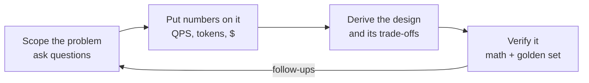

# AI system design interview playbook

A method for answering open-ended AI system design questions, written in my own words from a public talk on interview technique (credited by topic only, nothing quoted). It extends [interview-points.md](interview-points.md) and [defense-qa.md](defense-qa.md) rather than repeating them. Every number below is generated by `sysdesign/ext/envelope.py` via `scripts/render_interview.py`; CI fails if a table drifts from the code. Prices are illustrative inputs for generic tiers, not vendor quotes.

Worked cases: [docs/interview-cases/](interview-cases/README.md). Question bank: [interview-question-bank.md](interview-question-bank.md).

## 1. What the interviewer is actually scoring

The prompt is vague on purpose ("build an assistant for a lender"). The score comes from the order you work in:



| Signal | Junior answer | Senior answer |
|---|---|---|
| First 30 seconds | Names a framework, a vector store and a model | Asks who uses it, how often, and what one wrong answer costs |
| Architecture | Drawn before any numbers | Each box justified by a number or a requirement |
| Cost | "We'll optimise later" | Cost per conversation against a target, routing mix solved for it |
| Risk | "The model is accurate" | Abstain below a confidence level, human gate on writes, golden-set eval |
| Change | "Just upgrade the model" | Model and prompt versioned together, golden set rerun, rollback ready |
| Proof | Public benchmark scores | The envelope math plus a domain golden set |

The one-line version: components are remembered, decisions are derived.

## 2. The 45-minute budget

| Minutes | Phase | Output you should have at the end |
|---|---|---|
| 0-5 | Clarify | Users, frequency, latency feel, freshness, cost of an error, budget per request; functional vs non-functional list |
| 5-10 | Back-of-envelope | QPS, peak, tokens/day split into input and output, $/day and $/conversation |
| 10-25 | High-level design | Gateway, router, paths, guardrails, data stores, observability; user flow and data flow |
| 25-40 | Deep dive | The one or two components the numbers say are risky (retrieval, agent loop, routing, cache) |
| 40-45 | Wrap-up | Your own edge cases, what breaks first at 10x, what you would measure next |

The first ten minutes are cheap and feed the next thirty-five. For a 60-minute slot, keep clarify and envelope at about five minutes each and give the extra fifteen minutes to the high-level design and the deep dive, which is where most of the marks sit.

## 3. Five questions that each drive a decision

| Ask | Why it matters | Decision it drives | Where in this repo |
|---|---|---|---|
| How many users, how often? | Sets scale | Aggressive caching; small/mid/frontier routing tiers | `sysdesign/router.py`, `sysdesign/cache.py`, [caching.md](caching.md) |
| How fast must it feel? | Sets the latency budget | Streaming first token; a smaller model on the hot path | SSE in `sysdesign/app.py`, [latency.md](latency.md) |
| How fresh must the knowledge be? | Separates facts from behaviour | RAG with a reindex cadence (daily/weekly), not fine-tuning; fine-tune only for tone, format or behaviour | `sysdesign/ext/rag.py`, CDC invalidation in `cache.py` |
| What does one wrong answer cost? | Sets the safety bar | Human approval on writes, an eval gate, abstain below a confidence threshold | `sysdesign/agent.py`, `sysdesign/guardrails.py` |
| What is the budget per request or conversation? | Sets the economics | Model tier, routing mix, how many guards and humans you can pay for | `sysdesign/ext/envelope.py`, `sysdesign/ext/cost_model.py` |

Then add the classic software questions: functional requirements (chat UI, feedback thumbs, uploads), non-functional ones (latency, availability, cost), the user flow (sign in, ask, act, hand off) and the data flow (gateway, router, stores), including residency.

## 4. Back-of-envelope, computed

Illustrative tier prices used everywhere:

<!-- envelope:prices -->
| Tier | Input $/1M | Output $/1M |
|---|---|---|
| small | 0.15 | 0.60 |
| mid | 1.00 | 4.00 |
| frontier | 5.00 | 20.00 |
<!-- /envelope:prices -->

### Example A: a consumer assistant at 10M users, five requests each per day, one request per conversation

<!-- envelope:talk10m -->
| Quantity | Value |
|---|---|
| Conversations per day | 50M |
| Model requests per day | 50M |
| Average QPS (requests / 86,400) | 579 |
| Peak QPS (x3) | 1,736 |
| Tokens per request (system + context + output) | 500 + 2,000 + 500 = 3,000 |
| Input tokens per day | 125B |
| Output tokens per day | 25B |
| Tokens per day | 150B |
| Cost per day at 75% small / 20% mid / 5% frontier | $126,562 |
| Cost per day if everything went to frontier | $1,125,000 |
| Cost per conversation | $0.002531 |
<!-- /envelope:talk10m -->

Notice the split: most tokens are input, but output is priced higher per token, so never multiply total tokens by one price. The frontier-only row is why a router exists.

### Example B: 200k chats a day, eight turns each

<!-- envelope:talk200k -->
| Quantity | Value |
|---|---|
| Conversations per day | 200k |
| Model requests per day | 1.6M |
| Average QPS (requests / 86,400) | 18.5 |
| Peak QPS (x3) | 55.6 |
| Tokens per request (system + context + output) | 500 + 2,000 + 500 = 3,000 |
| Input tokens per day | 4B |
| Output tokens per day | 800M |
| Tokens per day | 4.8B |
| Cost per day at 75% small / 20% mid / 5% frontier | $4,050 |
| Cost per day if everything went to frontier | $36,000 |
| Cost per conversation | $0.0203 |
| Target per conversation | $0.02 |
| Meets target at the talk's mix? | no |
| Best-quality mix that fits (frontier >= 5%) | 80% small / 15% mid / 5% frontier = $0.0187/conversation |
<!-- /envelope:talk200k -->

### The planted mistake: "the daily cost is under the daily figure, so we're within budget"

The target in this example is per conversation, so a daily total proves nothing. Divide the daily cost by conversations per day and compare that with the per-conversation target:

<!-- envelope:planted -->
| Quantity | Value |
|---|---|
| Daily cost | $4,050 |
| Daily figure it was compared with | $6,000 |
| Daily comparison says | under |
| Conversations per day | 200k |
| Cost per conversation (daily cost / conversations) | $0.0203 |
| Per-conversation target | $0.02 |
| Per-conversation comparison says | over |
| What the daily figure silently allowed per conversation | $0.03 |
<!-- /envelope:planted -->

The daily comparison passes while every conversation is over target. The daily figure, spread over these conversations, quietly allowed a higher per-conversation spend than the target. The fix is the router mix in Example B's last row. Tested in `tests/test_interview_envelope.py::test_planted_mistake_daily_passes_conversation_fails`.

Reproduce from the CLI:

```bash
python -m sysdesign.ext.envelope --users 200000 --turns 8 --target 0.02 --min-frontier 0.05
```

## 5. Reference design: a bank assistant

Fully worked in [interview-cases/01-bank-assistant.md](interview-cases/01-bank-assistant.md). The shape: gateway, then an intent router. Most traffic is policy questions answered by RAG and a small model. Account actions go to a bounded agent loop where read tools are free and write tools (transfers) need human approval or a high-confidence gate. Sensitive or upset customers go to people. Every reply passes PII and "no personalised financial advice" guardrails. Traces, a golden set and canary releases sit around everything. Data residency (store in-country) is the common requirement; data in transit staying in-country is stricter and forces in-country inference too.

## 6. Defending the design

| Follow-up | Answer | Proof in repo |
|---|---|---|
| Why not fine-tune on the policies? | Policies change weekly; weights are a poor place for changing facts and retraining each change is slow and costly. Retrieval plus reindexing keeps facts current; fine-tuning is for style and behaviour. | `sysdesign/ext/rag.py`, CDC test in `tests/test_cache_cdc.py` |
| The vendor updated the model. Now what? | Pin model and prompt as one versioned pair, rerun the golden set on the new pair, canary it, roll back to the old pair on regression. | `test_version_pin_rolls_back`, `test_canary_shadow_ab` in `tests/test_talks_release.py` |
| How do you know it works? | The arithmetic says it fits the budget and latency; a domain golden set says it answers correctly. Public benchmarks are generic and say little about your policies. | this page, `test_functional_eval` |
| What breaks first at 10x? | Peak QPS and cost scale roughly linearly; provider quota, latency budget and spend are first. Caching and routing are the levers. | `scale()` rows in each case, `sysdesign/admission.py` |
| Why caching? | Many users ask near-identical questions; a hit skips retrieval and the model entirely. Cache only knowledge answers keyed by tenant and permissions. | [caching.md](caching.md), `tests/test_talk15_caching.py` |

## Limits

- Prices are illustrative and the peak factor is an assumption (the usual range is 2-5x). The math is linear; real systems are not.
- The quality ranking of tiers in `best_mix` is ordinal (small < mid < frontier); a real router is tuned against an eval set.
