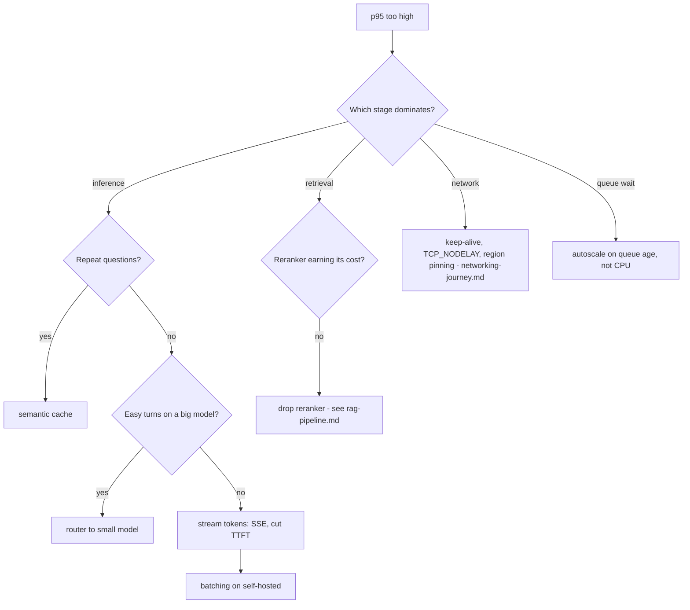

# Latency: where the time goes and what to do about it

In main's load model the model call dominates end-to-end time, so a faster model or fewer model calls (cache, intent ladder) beats tuning the gateway. See [load-test.md](load-test.md) for those numbers; they are not repeated here.

Batching at a fixed offered load (simulated GPU server on one machine, `loadtest/results/talks_benchmarks.json`, produced by `python -m loadtest.talks_benchmarks`):
| Batch | p50 ms | p95 ms | Throughput rps |
|---|---|---|---|
| 1 | 510.2 | 976.49 | 195.0 |
| 4 | 62.59 | 111.28 | 639.4 |
| 16 | 19.2 | 27.07 | 844.3 |
At batch 1 the server cannot keep up, so the time is queueing, not compute. Batching raises throughput and that removes the queue.

## Decision tree

