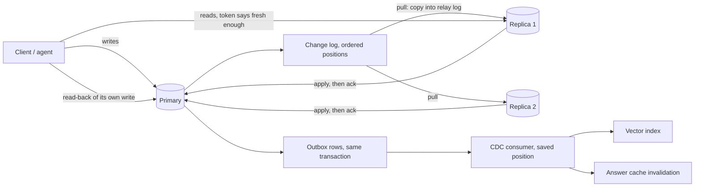
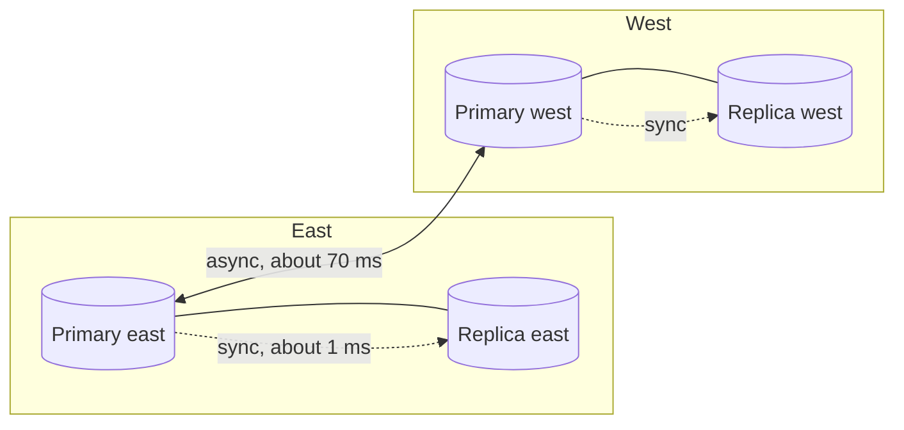

# Replication: primary and replicas, failover, two-region writes and change data capture

**Summary for recruiters.** This page covers how an AI app's database stays available and correct when
one copy is not enough. It has one primary with replicas, three commit modes, read-your-writes for
just-saved conversation turns, a failover drill with a fence, fast replica bootstrap, leaderless quorums,
two-region edits to agent memory, clock skew, and an outbox that keeps the vector index fresh. Every number
below comes from `python scripts/replication_bench.py`. These are **simulated runs with fixed seeds**:
times are simulated milliseconds and counts are exact counts from those runs. They are not benchmarks of
a real database.

Code: [`sysdesign/ext/replication.py`](../sysdesign/ext/replication.py) and
[`sysdesign/ext/multiregion.py`](../sysdesign/ext/multiregion.py). Tests:
[`tests/test_replication.py`](../tests/test_replication.py) and [`tests/test_multiregion.py`](../tests/test_multiregion.py).
Board: [`docs/img/replication_board.png`](img/replication_board.png).

**Who it is for.** Interview prep for system design rounds, and engineers who need to explain why a
chat history "disappeared" right after saving, or why a preference edit was lost between regions.

## Architecture





## How it works, step by step

1. **Write and log.** The primary applies a write and appends it to its change log with the next position (`Primary.write`).
2. **Pull.** Each replica copies entries after its last position into a relay log (`Replica.pull`).
3. **Apply.** The replica replays its relay log in order and records how far it got (`Replica.apply`). An entry it has already applied is skipped, so a replay is safe.
4. **Acknowledge.** What the client waits for depends on the mode: every replica (sync), the first replica (semi-sync), or nothing (async) (`commit_wait_ms`).

```python
def commit_wait_ms(mode: str, replica_ack_ms: list[float]) -> float:
    if mode == "sync":
        return max(replica_ack_ms)
    if mode == "semi-sync":
        return min(replica_ack_ms)
    if mode == "async":
        return 0.0
```

## 1. Commit modes: latency against data lost

There are two replicas and 400 writes a second. The network plus apply time for each copy has an
exponential tail. A crash counts as losing an acknowledged write when no replica has it yet.

<!-- BEGIN REPL_MODES -->
| Mode | Write p50 | Write p95 | Acked writes lost, one crash at end of 4,000 writes | Lost over 200 random crashes (busy stream) | Crashes with any loss |
| --- | ---: | ---: | ---: | ---: | ---: |
| sync | 4.152 ms | 9.009 ms | 0 | 0 | 0 of 200 |
| semi-sync | 2.372 ms | 4.749 ms | 0 | 0 | 0 of 200 |
| async | 0.4 ms | 0.4 ms | 2 | 1099 | 200 of 200 |
<!-- END REPL_MODES -->

Sync and semi-sync never acknowledge before a replica has the entry, so their 0 is guaranteed by how they work, and the run confirms it. Async is the fastest and is the only mode that loses writes.

## 2. Read-your-writes for AI sessions

A user saves a conversation turn or a thumbs-down, then the UI reads it back. Replica lag averages 40 ms
and the time before the read-back averages 30 ms. There are 2,000 sessions.

<!-- BEGIN REPL_RYW -->
| Read routing after a save | Stale reads | Reads sent to the primary |
| --- | ---: | ---: |
| always a replica | 1167 of 2000 (58.4%) | 0.0% |
| primary for 100 ms after a write | 2 of 2000 (0.1%) | 97.2% |
| write-position token (replica only if caught up) | 0 of 2000 (0.0%) | 42.2% |
<!-- END REPL_RYW -->

The token approach (`ReadRouter`) stores the position of the session's last write. A replica serves the read only if it has applied that position. This removes the stale reads and still sends most reads to replicas. A time window also works, but it sends almost everything to the primary.

## 3. Failover drill

Heartbeats go out every 500 ms. After 3 misses the primary is declared dead, and promotion takes 800 ms.
The replica that has applied the most is promoted, and the epoch goes up by one. When the old primary
comes back it still thinks it is in charge, and clients that cached its address keep writing to it.

<!-- BEGIN REPL_FAILOVER -->
| Run | Detect | Writes unavailable | Acked writes lost | Late writes to the old primary | Accepted (split brain) |
| --- | ---: | ---: | ---: | ---: | ---: |
| sync | 1417.5 ms | 2217.5 ms | 0 | 11 | 0 |
| semi-sync | 1417.5 ms | 2217.5 ms | 0 | 11 | 0 |
| async | 1417.5 ms | 2217.5 ms | 5 | 11 | 0 |
| async no fencing | 1417.5 ms | 2217.5 ms | 5 | 11 | 11 |
<!-- END REPL_FAILOVER -->

The epoch fence rejects every write that still carries the old epoch. Without the fence, the same writes are accepted, which means two primaries (split brain).

## 4. Bootstrapping a new replica

A full copy streams every row from the primary and then catches up on the writes that arrived in the
meantime. The faster way restores a recent snapshot taken from an existing replica, which records its log
position, and then replays only the log after that position. Assumptions: 20 GB of rows, a copy from the
primary throttled to 50 MB/s so it does not hurt live traffic, a 400 MB/s restore, a 5-minute-old
snapshot, 500 writes/s, and 20,000 applies/s.

<!-- BEGIN REPL_BOOTSTRAP -->
| Way to build a new replica | Catch-up time | Read from the primary |
| --- | ---: | ---: |
| Full copy from the primary (20.5 GB) | 420.1 s | 20,210,051 rows |
| Snapshot of an existing replica + log tail | 60.21 s | 175,600 log entries |

Speed-up x6.98; 99.1% less read from the primary. Real-object check: snapshot at position 3000, 800 tail entries pulled instead of 3800, contents match the primary: True.
<!-- END REPL_BOOTSTRAP -->

There is a known limit, and it is kept as a test: a very old snapshot of a small table can be slower than a full copy, because the replay outgrows the copy (`test_old_snapshot_can_lose_to_full_copy`).

## 5. Two regions writing: agent memory and user preferences

Each record is one user's agent memory (a set of saved facts) plus preferences (language, tone, units).
Both regions take writes, and a change reaches the other region 120 ms later. Version vectors track
exactly which edits each write had already seen. That separates three cases:

- an edit lost to a true concurrent edit
- an edit lost only because a clock was off
- an edit that was replaced on purpose, which is not a loss

<!-- BEGIN REPL_CONFLICTS -->
2000 records x 6 writes, 120 ms between regions, clocks in sync. 1147 records saw at least one pair of concurrent edits.

| Strategy | Updates silently dropped | Flagged for a decision |
| --- | ---: | ---: |
| Last-writer-wins (wall clock) | 374 of 12000 (3.1%) | 0 |
| Last-writer-wins (hybrid logical clock) | 374 (3.1%) | 0 |
| Version vectors (keep siblings) | 0 | 302 records |
| Custom merge (union facts, per-field preferences) | 0 | 56 preference fields |
<!-- END REPL_CONFLICTS -->

- **Last-writer-wins** keeps the record with the latest timestamp. Anything edited at the same moment in the other region disappears, and nothing reports it.
- **Version vectors** keep both versions when neither saw the other, so the app or a person can decide. Nothing is silently lost.
- **Custom merge** knows the data. Saved facts are a set, so it takes the union. Preferences merge field by field. Only two different values written to the same field at the same moment are flagged for the user.

## 6. Clock skew

Here the west region's clock runs behind. Last-writer-wins on wall-clock time can then keep an older
write over a newer one that had already seen it. A hybrid logical clock stamps every write later than
anything it has seen, so cause and effect stay in order whatever the skew is.

<!-- BEGIN REPL_SKEW -->
| West clock behind by | LWW wall: dropped | of which only because of the clock | LWW hybrid clock: dropped | of which because of the clock | Custom merge: dropped |
| ---: | ---: | ---: | ---: | ---: | ---: |
| 0 ms | 228 | 0 | 228 | 0 | 0 |
| 5 ms | 229 | 0 | 229 | 0 | 0 |
| 50 ms | 236 | 0 | 236 | 0 | 0 |
| 200 ms | 305 | 50 | 246 | 0 | 0 |
| 500 ms | 517 | 229 | 246 | 0 | 0 |
| 2000 ms | 1035 | 684 | 246 | 0 | 0 |
<!-- END REPL_SKEW -->

Below the replication delay, skew cannot reorder cause and effect, which is why the 0, 5 and 50 ms rows show no clock-caused drops. Once skew passes the delay, those drops climb quickly. The hybrid clock keeps them at 0 at every skew. The concurrent drops that remain are the price of last-writer-wins itself, and only a merge or siblings remove them.

## 7. Hybrid commit: sync in the region, async across regions

Each region has one primary and one in-region replica, about 1.2 ms away. The remote region is about
70 ms away. There are 300 random crash points.

<!-- BEGIN REPL_HYBRID -->
| Commit mode | Write p50 | Write p95 | Acked writes lost, node fails (mean) | Acked writes lost, region fails (mean / p95) |
| --- | ---: | ---: | ---: | ---: |
| all-async | 0.4 ms | 0.4 ms | 0.57 | 35.28 / 47 |
| local-sync+remote-async | 1.42 ms | 2.81 ms | 0.0 | 34.5 / 46 |
| all-sync | 68.3 ms | 84.68 ms | 0.0 | 0.0 / 0 |
<!-- END REPL_HYBRID -->

Waiting for the local replica costs about 1 ms and removes the loss when a single node fails. Surviving the loss of a whole region with no data lost costs a cross-region round trip on every write.

## 8. Leaderless quorums

N = 3 nodes. A write is acknowledged once W nodes have it. Each other node misses it half the time.
A read asks R nodes and keeps the highest version. Read repair writes that version back to the stale nodes it asked.

<!-- BEGIN REPL_LEADERLESS -->
| N | W | R | W+R>N | Read repair | Stale reads | Node copies behind at end |
| ---: | ---: | ---: | --- | --- | ---: | ---: |
| 3 | 1 | 1 | no | off | 1030 of 3150 (32.7%) | 288 |
| 3 | 1 | 1 | no | on | 1030 of 3150 (32.7%) | 288 |
| 3 | 1 | 2 | no | off | 236 of 3076 (7.7%) | 287 |
| 3 | 1 | 2 | no | on | 135 of 3076 (4.4%) | 166 |
| 3 | 2 | 1 | no | off | 548 of 3193 (17.2%) | 151 |
| 3 | 2 | 1 | no | on | 548 of 3193 (17.2%) | 151 |
| 3 | 2 | 2 | yes | off | 0 of 3128 (0.0%) | 152 |
| 3 | 2 | 2 | yes | on | 0 of 3128 (0.0%) | 81 |
| 3 | 3 | 1 | yes | off | 0 of 3143 (0.0%) | 0 |
| 3 | 3 | 1 | yes | on | 0 of 3143 (0.0%) | 0 |
<!-- END REPL_LEADERLESS -->

When W + R > N, the nodes read always include one that has the latest write, so there are no stale reads. Read repair doesn't change that, but it shrinks the number of node copies left behind. With R = 1 it has nothing to compare against, so it does nothing.

The majority CP/AP store in [`ext/distributed.py`](../sysdesign/ext/distributed.py) is the N = 3, W = R = 2 case of this.

## 9. Change data capture: keeping the vector index and cache fresh

The document and an outbox row are written in **one SQLite transaction**, so neither can exist without
the other. A consumer:

- reads the outbox in order
- calls the existing `KnowledgeIndex.apply_change`, which re-embeds only chunks whose content changed
- clears the cache entries built on those chunks
- then saves its position

Every 7th poll it is killed after applying and before saving its position, so it replays that batch on restart.

<!-- BEGIN REPL_CDC -->
| Measure | Value |
| --- | ---: |
| Changes committed (data + outbox row in one transaction) | 1481 |
| Index staleness p50 / p95 / max (poll every 200 ms) | 113.2 / 192.7 / 205.1 ms |
| Consumer crashes before saving its position | 21 |
| Events replayed after those crashes | 214 |
| Documents where index and database disagree at the end | 0 of 115 |
| App crashes inside the transaction (nothing committed, nothing to lose) | 19 |
| Index updates a dual write would lose at those same crash points | 19 |
<!-- END REPL_CDC -->

Replays are harmless: the index is keyed by content hash, so a replayed event re-embeds nothing (`test_consumer_resumes_from_saved_position_after_crash`). The dual-write row counts the same crash points under the naive design, where the app saves the document and then calls the index separately.

**In practice.** A large social network built a dedicated change-capture service that reads the database's change log and feeds search indexes and caches downstream. That is the same pattern at much bigger scale. Many teams run a log-based capture tool between the database and a stream for the same job.

## How to run

```bash
pip install -r requirements-dev.txt
python -m pytest -q tests/test_replication.py tests/test_multiregion.py
python scripts/replication_bench.py          # rewrite docs/results/replication.json and the tables here
python scripts/replication_board.py          # rewrite docs/img/replication_board.png
python scripts/replication_bench.py --check  # what CI runs
```

Everything runs offline in about two seconds. It needs no cloud resources and no database server.

## Guardrails

- The read-back of a session's own write never comes from a replica that is behind (position token).
- Failover always goes through an epoch fence, so the old primary cannot keep accepting writes.
- Concurrent edits to agent memory are never dropped silently: they are either merged or flagged.
- Index updates only come from the outbox, never from a second write after the commit.

## Limitations and known failures

- Everything is simulated. The latency distributions are assumptions picked to have a realistic shape, not measurements of a database.
- Failover detection uses a fixed heartbeat. There is no consensus protocol, so a network split between the replicas themselves is out of scope.
- The leaderless model has no hinted handoff and no anti-entropy sync in the background.
- The custom merge only resolves the two shapes it knows: a set of facts and preference fields. Other data needs its own rule.
- A known miss is kept as a test: an old snapshot can be slower than a full copy.

## Built vs planned

| Piece | Status |
| --- | --- |
| Change log, relay log, apply, sync/semi-sync/async, crash-loss trials | Built (simulated) |
| Read-your-writes token router | Built (simulated) |
| Failover drill with epoch fence | Built (simulated) |
| Snapshot plus tail bootstrap (real objects plus a timing model) | Built (simulated) |
| Two-region LWW / version vectors / custom merge, clock-skew sweep, hybrid logical clock | Built (simulated) |
| Hybrid commit mode (local sync, remote async) | Built (simulated) |
| Leaderless N/W/R with read repair | Built (simulated) |
| Outbox CDC into the real `KnowledgeIndex` and cache, with consumer crash and resume | Built (real SQLite, simulated clock) |
| Same drills against a real Postgres primary and streaming replica in CI | Planned |
| CDC from a real database change log instead of an outbox table | Planned |

## Interview points

- Ask what a lost write costs before you pick a mode. Semi-sync is the usual middle ground.
- "I saved it and it vanished" is a read-your-writes problem. Route by write position, not by time.
- Failover without a fence produces two primaries. Promote the most caught-up replica.
- Last-writer-wins is quietly lossy, and clock skew makes it worse. Use a hybrid logical clock for ordering, and version vectors or a domain merge for true conflicts.
- Keep derived stores (vector index, cache, search) in sync from the change log or an outbox, never with dual writes, and state the staleness window you are promising.

## Related repos

- [Jagadish-event-driven-agents](https://github.com/jagadishmazure-jpg/Jagadish-event-driven-agents): event bus replay for late subscribers.
- [Jagadish-agentic-data-layer](https://github.com/jagadishmazure-jpg/Jagadish-agentic-data-layer): data contracts and lineage for the derived stores.
