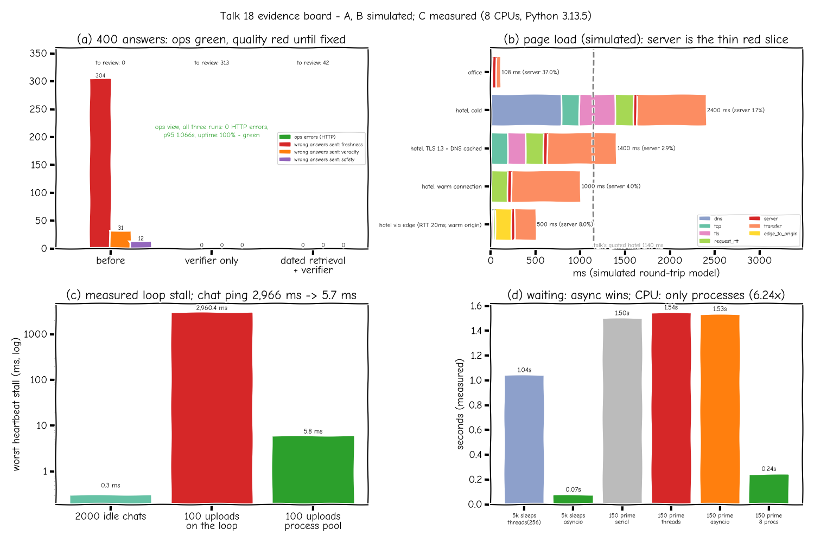

# Talk 18 (A): green dashboards, wrong answers

Source: a public talk on AI system design, credited by topic only and written here in my own words. Everything below is a **simulation** (seeded, offline). The store, its policies and its customers are made up. Numbers come from `python scripts/talk18_bench.py` (`docs/results/talk18.json`), and a test fails if the committed file drifts from a fresh run.

## The story (fictional)

Larkspur Home's support bot had been live for two weeks. A customer whose sofa arrived 45 days earlier asked about a refund, and the bot said yes, because the refund window was 60 days. Last quarter that window had been cut to 30 days. The team's dashboard showed fast replies, zero errors and full uptime the whole time.

Both sides were right. The dashboard measured delivery: did a reply go out, and how fast. The customer saw content: was the reply true. A cache or a database that breaks tells its caller with an error. A language model that is handed an old document just writes a fluent, confident reply from it, and the request still ends in a 200.

## Break the problem apart

| Stage | What went wrong | Measured by the old dashboard? |
|---|---|---|
| Index | both policy versions were indexed, with no dates | no |
| Retrieval | ties went to the older copy, so the 60-day text came back | no |
| Model | answered faithfully from what it was given | no |
| Delivery | 200 OK, about 1 s | yes (all green) |

So the fix is not a better model. It is (1) dated documents, (2) a check on the answer itself, and (3) a person for the doubtful ones.

## What was built (`sysdesign/ext/freshness.py`)

1. **Dated policy versions.** Each `PolicyVersion` has `version`, `effective_from` and `superseded_on`, plus the machine-readable rule (`refund_window_days: 30`). `PolicyStore.search(..., exclude_superseded=True)` only ranks versions in force on the given date. Asking "as of March" still returns the 60-day rule, which is right for a March complaint.
2. **Freshness check.** `freshness_check` pulls stated values out of the answer ("60-day", "within 30 days", "1 year") and flags any value that matches a superseded version but not the current one.
3. **Answer verifier.** `verify` reuses the talk 3 grounding check (`ext/grounding.py`, the one behind `test_grounding_blocks_invented_number`): every number in the answer must appear in the evidence handed to the model. It adds the freshness check and a PII check, and turns them into a groundedness share and a confidence score. Below 0.8 the answer goes to `ReviewQueue` instead of the customer. The queue stores redacted text only.
4. **Two dashboards.** `replay()` sends 400 seeded questions through a fake model that answers from the top document. 6% of the time it adds an invented "15% restocking credit", and 3% of the time it echoes an email address. Ground truth is judged against the current policy, independent of the verifier.

## Results (simulated, 400 answers per run)

| Run | Ops view: HTTP errors / p95 / uptime | Stale answers sent | Invented facts sent | PII sent | Sent to human review |
|---|---|---|---|---|---|
| Before (undated index, no verifier) | 0 / 1.066 s / 100%: **green** | 304 | 31 | 12 | 0 |
| Verifier only (index still undated) | 0 / 1.066 s / 100%: green | 0 | 0 | 0 | 313 |
| Dated retrieval + verifier | 0 / 1.066 s / 100%: green | 0 | 0 | 0 | 42 |

What this shows:
- The ops view is identical in all three runs. It could not have caught the incident.
- In the before run, the customer-facing replies carry 347 problems across 400 answers (304 stale, 31 invented, 12 PII), and the quality view is red (freshness score 0.24).
- A verifier on its own is a safety net, not a fix. It caught every stale answer but sent 313 of 400 (78%) to people. Fixing retrieval at the source cut that to 42 (10.5%), and those 42 are exactly the invented-fact and PII cases.

## Limits (kept honest)

- The fake model fails only in the ways the checks look for, so "0 sent" is a regression check of the wiring, not a quality claim about any real model.
- Value extraction uses regexes for three rules. A paraphrase like "a month" would slip past the freshness check. Real systems need rule IDs in the documents, or an LLM-as-judge calibrated against human labels.
- Latency in the replay is simulated. Nothing here measures review-queue staffing or how long people take.

## Deeper evaluation lives elsewhere

- [Jagadish-agentic-rag](https://github.com/jagadishmazure-jpg/Jagadish-agentic-rag): faithfulness scoring, abstaining when unsure, and human handoff in a full RAG pipeline.
- [Jagadish-llm-evals-observability](https://github.com/jagadishmazure-jpg/Jagadish-llm-evals-observability): judge calibration, drift monitoring and quality dashboards.

## Interview points

- A 200 means "delivered", not "correct". Name the quality dimensions (accuracy, freshness, safety) and say how each is measured.
- Fix the cause (dated retrieval) before adding a net (verifier). A net alone moves the cost onto human reviewers.
- Keep the decision rule simple: break the system into stages, ask which stage has no metric, add that metric, then act on it.
